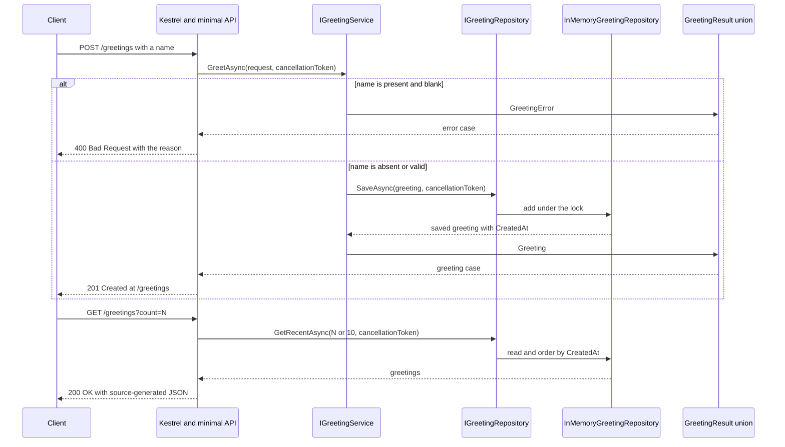
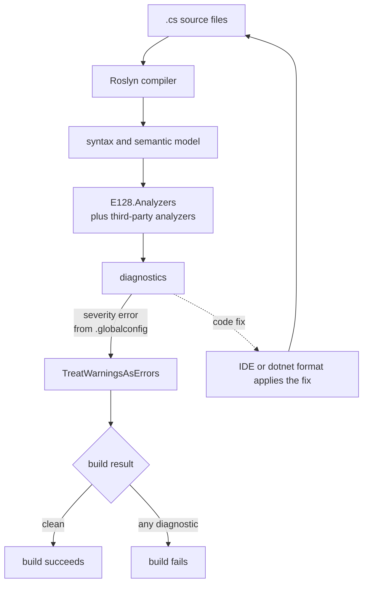

# Data Flow: E128.Reference

> **One sentence:** Two flows matter: a greeting request moving through the web service's injected domain layer at runtime, and source code moving through the analyzer pipeline at build time.

*Updated: 2026-11-11T03:24:51Z*

---

## Runtime Data Flow: Greeting Request

The composition root is `Program.cs` in top-level statements. It sets the minimum log level to Warning, registers `Greeter`, `TimeProvider.System`, `IGreetingRepository` to `InMemoryGreetingRepository`, `IGreetingService` to `GreetingService`, and health checks, all as singletons. It then maps the four endpoints.

## Build-Time Data Flow: Analyzer Pipeline

## Ingress Patterns

| Entry point    | Mechanism                                                          |
| -------------- | ------------------------------------------------------------------ |
| HTTP request   | Kestrel routes to a minimal API delegate                           |
| CLI invocation | System.CommandLine parses `args` and invokes the handler           |
| Build          | Roslyn feeds source into the analyzers                             |
| Configuration  | Options classes bound from configuration, which E128033 guards     |

## Processing Pipelines

- **Greeting**: the request reaches `GreetingService.GreetAsync`, which validates the name, builds the greeting through `Greeter`, stamps it with `TimeProvider.GetUtcNow`, and writes it through the repository. A `CancellationToken` is threaded through, and the analyzers enforce that across the codebase.
- **Time**: every time read goes through an injected `TimeProvider`. E128003 forbids a direct `DateTime.Now` or `DateTime.UtcNow`.
- **Failure**: an expected failure travels as the `GreetingError` case of the union, not as an exception, so the caller cannot ignore it.

## Egress Patterns

| Exit          | Mechanism                                                                |
| ------------- | ------------------------------------------------------------------------ |
| HTTP response | `Results.Ok`, `Results.Created`, `Results.BadRequest`, `Results.Problem` |
| Health        | `GET /health` health check response                                      |
| Diagnostics   | compiler diagnostics to CI logs and IDE squiggles                        |
| Package       | `dotnet pack` to `.nupkg`, then nuget.org for the analyzer               |

## Data Lifecycle

Runtime greeting data lives only in process memory and is lost on restart, which suits a reference demonstrator. The durable data of the repository is its source and its metadata. `PublicAPI.Shipped.txt` and `PublicAPI.Unshipped.txt` track the analyzer public surface, and `AnalyzerReleases.Shipped.md` and `AnalyzerReleases.Unshipped.md` track the rule surface across versions. See [storage.md](storage.md).
