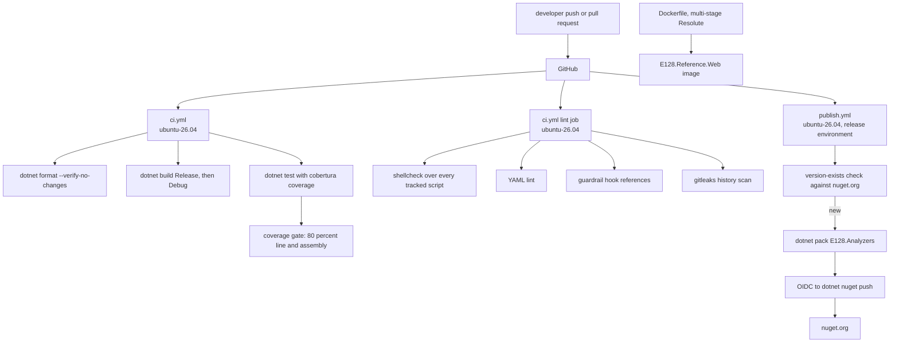
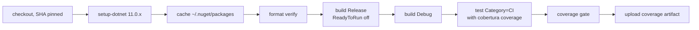

# Deployment and Delivery: E128.Reference

> **One sentence:** Two GitHub Actions workflows drive delivery: `ci.yml` runs format, build, and test on every push and pull request, and `publish.yml` trusted-publishes the analyzer package to nuget.org when its source changes. The web service ships as a multi-stage Resolute container built with Podman.

*Updated: 2026-11-11T03:24:51Z*

---

## Resource Architecture

## Infrastructure as Code

No cloud infrastructure as code is present. There is no Terraform, Bicep, or ARM template. The infrastructure artifacts are these:

| Artifact                        | Purpose                                                      |
| ------------------------------- | ------------------------------------------------------------ |
| `Dockerfile`                    | multi-stage Resolute build of the web service                |
| `.github/workflows/ci.yml`      | `ci` and `lint` jobs                                         |
| `.github/workflows/publish.yml` | analyzer pack and OIDC push                                  |
| `renovate.json`                 | dependency updates with a three-day release age              |
| `scripts/podman.sh`             | local Podman build, test, run, stop, and clean               |
| `nuget.config`                  | source mapping, trusted signers, and the publish age guard   |

## CI/CD Pipeline

### Branch strategy

- Trunk-based on `main`. Work happens on `feature/`, `fix/`, or `refactor/` branches.
- One squashed commit per pull request.
- `ci.yml` triggers on a push to `main` and on a pull request targeting `main`.

### The `ci` job on `ubuntu-26.04`

The job runs `dotnet format ... --verify-no-changes`, builds Release and Debug, runs the CI-category tests with coverage, and fails when line coverage or per-assembly coverage falls below 80 percent. Locally, the same gate is `scripts/check.sh`, and `scripts/ci.sh` adds the shell lint.

### The `lint` job on `ubuntu-26.04`

Shell lint, YAML lint, catalog checks, guardrail hook reference checks, and a gitleaks history scan share one runner and one full-history checkout.

### `publish.yml`, the analyzer release

- **Trigger**: a push to `main` that touches `src/E128.Analyzers/**` or `src/E128.Analyzers.CodeFixers/**`.
- **Gate**: reads `<Version>` from the csproj and queries the nuget.org flat-container API. It skips a version that nuget.org already carries.
- **Auth**: `id-token: write` plus the `release` environment. The OIDC token is exchanged for a temporary publish key, so no NuGet API key is stored.
- **Steps**: checkout, version check, setup-dotnet, cache, `dotnet pack`, `dotnet nuget push`.

## Provisioning

No environment is provisioned, because there is no cloud footprint. A consuming repository provisions itself by adding the `E128.Analyzers` package reference with `PrivateAssets="all"`.

## Secrets Management

| Secret class             | Handling                                              |
| ------------------------ | ----------------------------------------------------- |
| NuGet publish credential | OIDC short-lived token, never stored                  |
| GitHub Actions versions  | pinned by commit SHA                                  |
| Application secrets      | none, because the reference apps have none            |

`gitleaks` scans the whole history in CI and the staged diff in the pre-commit gate.

## Monitoring and Alerting

| Tool                                     | Tracks                                     |
| ---------------------------------------- | ------------------------------------------ |
| GitHub Actions status                    | build, test, and publish result per push   |
| `GET /health` on the web service         | runtime liveness                           |
| `Microsoft.Testing.Extensions.HangDump`  | hung tests in CI                           |
| `Microsoft.Testing.Extensions.TrxReport` | structured test results                    |
| Coverage artifact and job summary        | line and per-assembly coverage             |
| Renovate                                 | dependency drift and known vulnerabilities |
