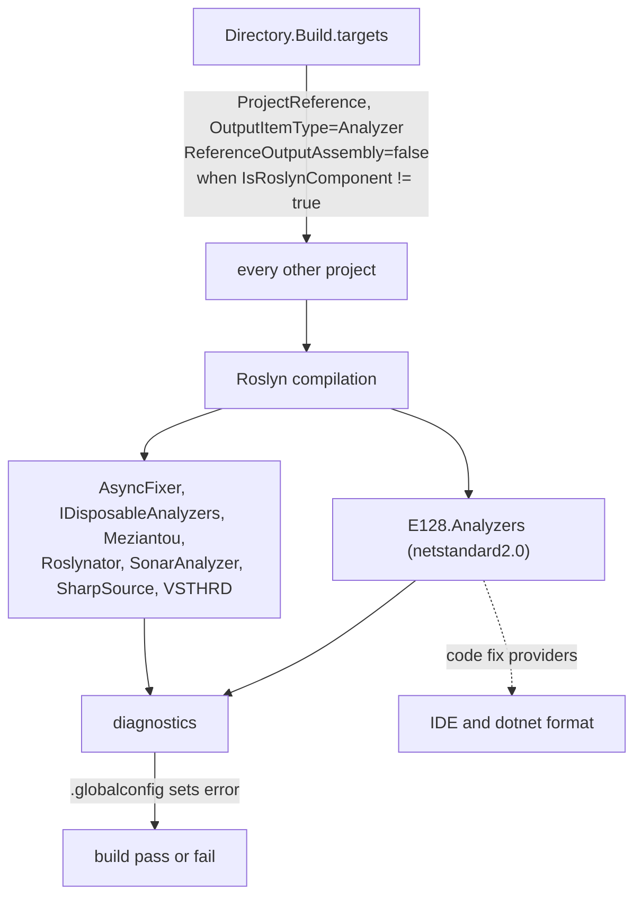

# Integration Patterns: The E128.Analyzers Suite

> **One sentence:** The flagship integration is the build-time one: `E128.Analyzers` joins every project's Roslyn compilation as a project reference and reports 214 diagnostics in eight categories, most with a one-click code fix.

*Updated: 2026-11-11T03:24:51Z*

---

## How the Analyzer Integrates

Both analyzer assemblies target `netstandard2.0`, so one build loads in the current Roslyn host and in any newer host. The support window is `net11.0`, and the repository tests that host only. As of 2026-11-11 the suite holds 214 diagnostic IDs across 207 analyzer classes in about 63k lines of source. Run `scripts/analyzer-stats.sh` for the current numbers.

Severity defaults differ by surface. `src/E128.Analyzers/README.md` documents the per-rule default for an external consumer. Inside this repository, `.globalconfig` promotes every diagnostic to `error`.

> **Severity note.** Several rules ship below Warning for a consumer: `E128021`, `E128050`, `E128059`, `E128063`, and `E128080` default to Error, and `E128030`, `E128052`, `E128072`, and `E128081` default to Info. The repository blanket overrides all of them.

## Rule Catalog by Category

The tables below name representative rules. `src/E128.Analyzers/README.md` is authoritative for the full set, and `scripts/readme-table-diff.sh --analyzer` proves that file against the source. "Fix" means a code fix provider exists.

### Design, 34 rules

| Rule    | Title                                                              | Fix |
| ------- | ------------------------------------------------------------------ | --- |
| E128001 | Use `FileInfo` or `DirectoryInfo` instead of `string` paths        | Yes |
| E128003 | Use `TimeProvider` instead of `DateTime.Now`                       | Yes |
| E128004 | Use `IHttpClientFactory` instead of `new HttpClient()`             | Yes |
| E128005 | Seal a class that has no subclass                                  | Yes |
| E128032 | Concrete-only DI registration with an available interface          | Yes |
| E128050 | Use `TimeSpan` for a time-duration value                           | Yes |
| E128061 | Use `ImmutableArray<T>` for a static readonly array                | Yes |
| E128080 | Use `ByteSize` for a data-size value                               | Yes |

### Reliability, 66 rules

| Rule    | Title                                                              | Fix |
| ------- | ------------------------------------------------------------------ | --- |
| E128011 | `[GeneratedRegex]` missing a match timeout                         | Yes |
| E128023 | Avoid a hardcoded `/tmp` path                                      | Yes |
| E128039 | A catch filter must exclude `OperationCanceledException`           | Yes |
| E128041 | `JsonDocument.RootElement` must not escape its `using` scope       | Yes |
| E128056 | `FileInfo.Exists` then read, a time-of-check to time-of-use race   | Yes |
| E128064 | Disk write then read round trip, which needs an in-memory value    | Yes |
| E128109 | `stackalloc` must be bounded and outside a loop                    | No  |
| E128110 | Zero a pooled buffer in `finally` before `Return`                  | No  |

### Performance, 54 rules

| Rule    | Title                                                              | Fix |
| ------- | ------------------------------------------------------------------ | --- |
| E128009 | Use `MinBy` or `MaxBy` instead of `OrderBy().First()`              | Yes |
| E128010 | Pass `HttpCompletionOption.ResponseHeadersRead`                    | Yes |
| E128026 | Redundant `HashSet` allocation in a `FrozenSet` creation           | Yes |
| E128027 | Use a frozen collection for a static readonly collection           | Yes |
| E128066 | Linear lookup inside a loop, which is O(n²)                       | Yes |
| E128083 | Use `ImmutableCollectionsMarshal.AsImmutableArray` to avoid a copy | Yes |
| E128152 | Complexity past the `e128_max_complexity` ceiling                  | Yes |
| E128215 | `StringBuilder` created without capacity for a known append count  | Yes |

### Security, 21 rules

| Rule    | Title                                                               | Fix |
| ------- | ------------------------------------------------------------------- | --- |
| E128071 | Use a FIPS-approved hash algorithm                                  | Yes |
| E128075 | Use `RandomNumberGenerator` instead of `Random` in a crypto context | Yes |
| E128202 | Unvalidated JWT claims used as an identity                          | No  |

### Unsafe, 17 rules

| Rule    | Title                                                              | Fix |
| ------- | ------------------------------------------------------------------ | --- |
| E128112 | Use `Unsafe.BitCast` instead of `Unsafe.As`                        | Yes |
| E128120 | Do not skip local initialization without a measured reason         | Yes |

### Style, 13 rules

| Rule    | Title                                                              | Fix |
| ------- | ------------------------------------------------------------------ | --- |
| E128002 | Use `string.Empty` instead of `""`                                 | Yes |
| E128006 | Use `Encoding.UTF8` instead of `Encoding.Default`                  | Yes |
| E128024 | Non-XML-doc comment above a method declaration                     | Yes |
| E128043 | Do not use the null-forgiving operator                             | Yes |
| E128047 | `#pragma warning disable` without a justification comment          | Yes |
| E128063 | Mid-name underscore in a private static member                     | Yes |

### Testing, 11 rules

| Rule    | Title                                                              | Fix |
| ------- | ------------------------------------------------------------------ | --- |
| E128054 | Class creates a temp directory without a cleanup interface         | Yes |
| E128062 | Test uses an outdated `ReferenceAssemblies` for the project TFM    | Yes |
| E128073 | Test method missing `[Trait("Category", ...)]`                     | Yes |
| E128171 | Committed `Assert.Fail` red-phase stub                             | No  |

### Maintainability, 4 rules

| Rule    | Title                                                              | Fix |
| ------- | ------------------------------------------------------------------ | --- |
| E128203 | HTTP request inside a loop, which creates N+1 round trips          | Yes |
| E128218 | Boolean flags encode one state                                     | No  |

## Third-Party Analyzers Run Alongside

| Package                                          | Prefix | Focus                          |
| ------------------------------------------------ | ------ | ------------------------------ |
| AsyncFixer                                       | AF     | async and await anti-patterns  |
| IDisposableAnalyzers                             | IDISP  | resource ownership             |
| Meziantou.Analyzer                               | MA     | quality, performance, security |
| Microsoft.VisualStudio.Threading.Analyzers       | VSTHRD | threading correctness          |
| Roslynator.Analyzers and companions              | RCS    | style, quality, formatting     |
| SharpSource                                      | SS     | common pitfalls                |
| SonarAnalyzer.CSharp                             | S      | security and reliability       |

## Code-Fix Patterns

Most fixes are local expression or declaration rewrites that Roslyn's `BatchFixer` applies. A rename, such as the E128063 mid-name underscore or an IDE1006 naming fix, uses the shared `SequentialRenameFixAllProvider` instead, because `BatchFixer` cannot merge two renames that touch one document. A cross-kind fix, such as the E128064 disk round trip, wraps the value in `Encoding.UTF8.GetBytes` or `GetString` and adds the `using`. [code-fix-patterns.md](../../lode/dotnet/analyzers/code-fix-patterns.md) has the maintainer detail.
