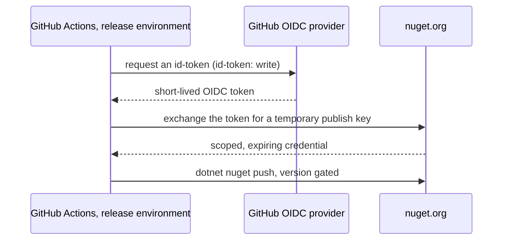
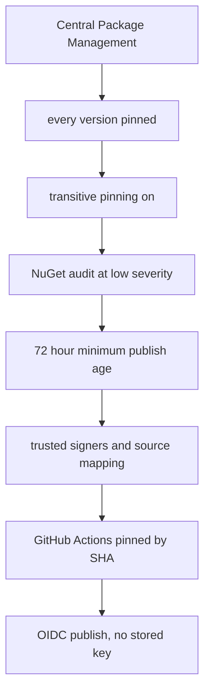
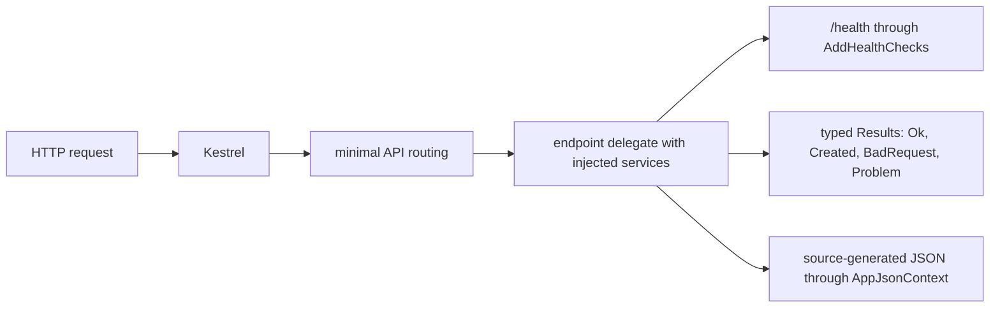

# Security: E128.Reference

> **One sentence:** Security here is build-time and supply-chain first: deny-by-default analysis, analyzer-enforced safe patterns, OIDC publishing with no stored secret, and a pinned, age-gated dependency graph, because the reference apps carry no authentication surface.

*Updated: 2026-11-11T03:24:51Z*

---

## Authentication

The reference web and CLI apps implement no end-user authentication. They are demonstrators. The only authenticated flow is the release pipeline, which uses OIDC trusted publishing:

## Authorization

| Mechanism             | Where                                                                |
| --------------------- | -------------------------------------------------------------------- |
| Workflow permissions  | `contents: read` baseline, `id-token: write` only in the publish job |
| `release` environment | gates the publish job through environment protection rules           |
| Branch protection     | `main` is gated by the `ci` and `lint` jobs                          |

## API Security

The reference API shows safe defaults rather than a full security stack.

| Control              | Status in the reference                                                |
| -------------------- | ---------------------------------------------------------------------- |
| Input model          | typed `GreetingRequest` binding                                        |
| Validation           | a null name means the default, and a blank name returns the error case |
| Cancellation         | `CancellationToken` threaded through every async endpoint              |
| Error detail         | the operator-facing `GreetingError` message, with no stack trace       |
| Rate limiting, CORS  | not implemented, which is out of reference scope                       |
| Health probe         | `GET /health` exposed                                                  |
| Response compression | not enabled, so the `EnableForHttps` risk does not apply               |

## Data Security Through the Analyzers

The analyzer suite is itself a security control. The important rules:

| Rule             | Protects against                                                              |
| ---------------- | ----------------------------------------------------------------------------- |
| E128071          | non-FIPS hash algorithms (MD5, SHA1, DES, RC2, 3DES, HMAC-MD5, HMAC-SHA1)     |
| E128075          | `System.Random` in a crypto context, where `RandomNumberGenerator` belongs    |
| E128011          | `[GeneratedRegex]` without a timeout, which allows catastrophic backtracking  |
| E128013, E128014 | overlapping or nested regex quantifiers, which allow exponential backtracking |
| E128056          | `FileInfo.Exists` followed by a read, a time-of-check to time-of-use race     |
| E128064          | a disk write then read round trip, which adds a race window and a syscall     |
| E128023, E128025 | a hardcoded `/tmp` path and a predictable temporary name                      |
| E128041          | `JsonDocument.RootElement` escaping its `using` scope                         |
| E128039, E128051 | a catch filter that swallows `OperationCanceledException`                     |
| E128086          | an `ArrayPool` buffer used as a `SqliteParameter` value without `Size`        |
| E128202          | unvalidated JWT claims used as an identity                                    |

E128071 and E128075 are compile-time algorithm-selection checks. They steer code toward a FIPS-approved algorithm and a cryptographic random source. They are not a FIPS 140-2 validated module, because that validation would need a certified cryptography provider in the container OS, and the stock Resolute image ships none. [podman.md](../../lode/infrastructure/podman.md) has the detail.

## Supply-Chain Security

| Control                | File or mechanism                          |
| ---------------------- | ------------------------------------------ |
| Version pinning        | `Directory.Packages.props`                 |
| Transitive pinning     | `CentralPackageTransitivePinningEnabled`   |
| Vulnerability auditing | NuGet audit at low severity                |
| Source restriction     | `nuget.config` source mapping and clear    |
| Signature verification | `nuget.config` trusted signers             |
| Minimum publish age    | `minPublishAgeHours` 72 hours              |
| Action pinning         | workflow actions pinned by commit SHA      |
| No long-lived secret   | OIDC trusted publishing                    |
| Secret scanning        | gitleaks in CI and pre-commit              |

The minimum publish age gates automatic version selection only. It covers `dotnet package add`, `dotnet package update`, and a floating version. An ordinary restore of a pinned version ignores it, so it is not an age check on the whole dependency graph.

## Multi-Tenancy Security

Not applicable. The reference apps are single-tenant and stateless.

## Middleware and Request Pipeline

The pipeline is intentionally minimal. No authentication or authorization middleware is registered, and the demonstrator stays focused on idiomatic wiring. A production build would add authentication, authorization, a rate limiter, CORS, and TLS enforcement at the host.
