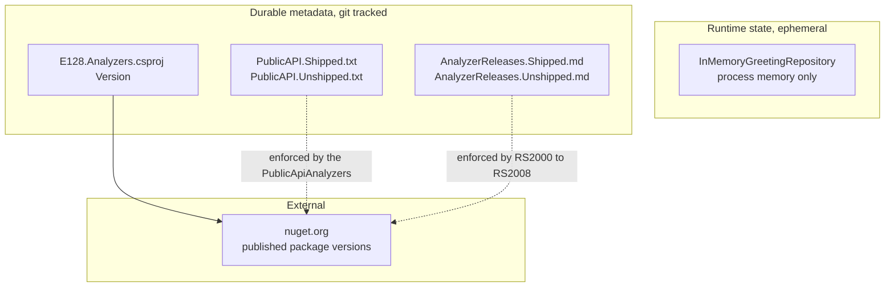
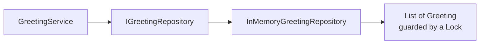
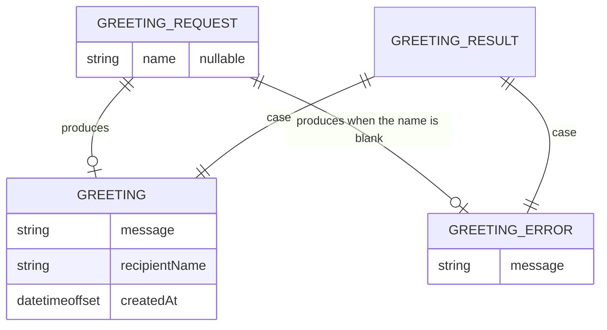

# Storage and State: E128.Reference

> **One sentence:** There is no database, so runtime state is one in-memory repository, and the durable state that matters is the analyzer's PublicAPI and release-tracking metadata.

*Updated: 2026-11-11T03:24:51Z*

---

## Storage Landscape

## Data Model

| Concern             | Model                                                                |
| ------------------- | -------------------------------------------------------------------- |
| Runtime persistence | In memory, single process, non-durable. No tenant model applies.     |
| Domain entities     | `Greeting`, `GreetingRequest`, `GreetingError`, `GreetingResult`     |
| Relational schema   | None. The reference avoids a database to stay minimal                |

`Greeting` is a sealed record of `Message`, `RecipientName`, and `CreatedAt`. `GreetingRequest` carries a nullable `Name`. `GreetingError` carries the operator-facing `Message`. `GreetingResult` is a `readonly union` of `Greeting` and `GreetingError`.

## Data Access Pattern

Runtime access goes through `IGreetingRepository`, with `InMemoryGreetingRepository` as the only implementation, resolved through dependency injection. There is no ORM, no connection string, and no SQL. The interface marks the seam where a real persistence implementation would sit.

The implementation holds a `Lock` and a `List<Greeting>`. A write appends under the lock. A read copies the newest `count` entries, ordered by `CreatedAt` descending, before it releases the lock.

## Key Data Objects

None. The repository holds no `appsettings.json` connection string, no migration, and no stored procedure.

## Schema Management for Analyzer Metadata

The analyzer treats its public API and its rule set as schema, and Roslyn's own analyzers manage both.

| Artifact                        | Managed by                                  | Rules            |
| ------------------------------- | ------------------------------------------- | ---------------- |
| `PublicAPI.Shipped.txt`         | `Microsoft.CodeAnalysis.PublicApiAnalyzers` | RS0016, RS0017   |
| `PublicAPI.Unshipped.txt`       | the same analyzer                           | RS0016, RS0017   |
| `AnalyzerReleases.Shipped.md`   | Roslyn release-tracking analyzers           | RS2000 to RS2008 |
| `AnalyzerReleases.Unshipped.md` | the same analyzers                          | RS2000 to RS2008 |

A new rule or API lands in the `Unshipped` file first. At release, `scripts/internal/analyzer-promote.sh` moves the rule rows into a `## Release <version>` section of the shipped file. `scripts/internal/analyzer-release-check.sh` validates the pair against the source.

## Entity Relationships

The diagram shows the shape of the Core models. The types are intentionally small, and `src/E128.Reference.Core/Models/` is the source of truth.
