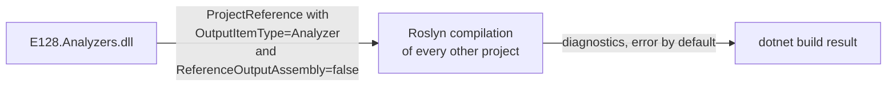
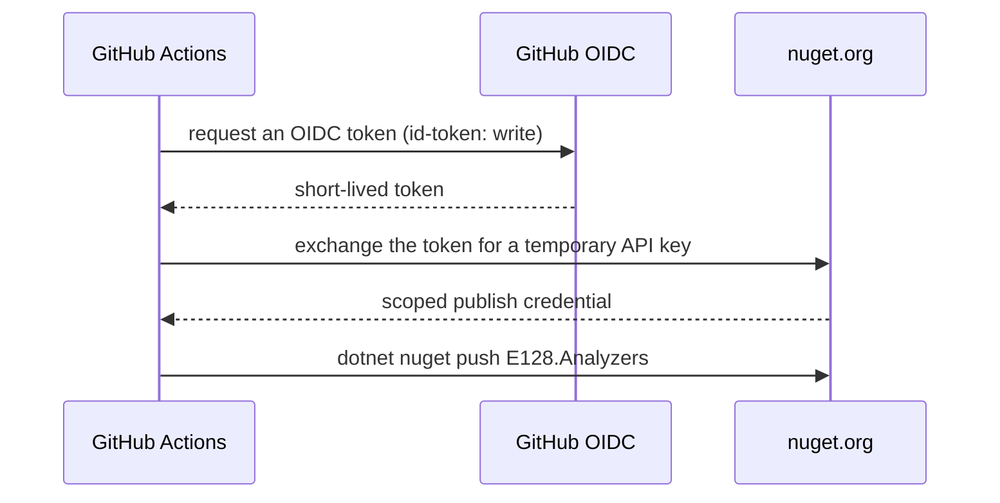
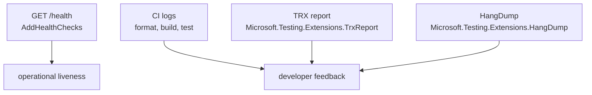

# System Architecture: E128.Reference

> **One sentence:** A single .NET 11 solution of five production projects (Core, Web, Cli, Analyzers, CodeFixers), a benchmark project, and five test projects, governed by shared MSBuild props and a build-time analyzer reference that analyzes every other project.

*Updated: 2026-11-11T03:24:51Z*

---

## Component Map

```mermaid
graph TB
  subgraph build["Shared build configuration (repo root)"]
    props["Directory.Build.props<br/>TFM, analysis, analyzer packages"]
    targets["Directory.Build.targets<br/>runtime async, MTP, analyzer ProjectReference"]
    pkgs["Directory.Packages.props<br/>CPM version pins"]
    gj["global.json<br/>SDK 11.0.100 and MTP runner"]
    gc[".globalconfig<br/>deny-by-default severities"]
    ec[".editorconfig<br/>style and formatting"]
  end

  subgraph prod["src/ production"]
    core["E128.Reference.Core<br/>(net11.0) domain library"]
    web["E128.Reference.Web<br/>(net11.0) minimal API"]
    cli["E128.Reference.Cli<br/>(net11.0) System.CommandLine"]
    ana["E128.Analyzers<br/>(netstandard2.0) Roslyn suite"]
    fix["E128.Analyzers.CodeFixers<br/>(netstandard2.0) code fixes"]
  end

  subgraph bench["benchmarks/"]
    benchp["E128.Benchmarks<br/>(net11.0) BenchmarkDotNet"]
  end

  subgraph test["tests/"]
    coret["E128.Reference.Core.Tests"]
    webt["E128.Reference.Tests<br/>integration and Podman smoke"]
    clit["E128.Reference.Cli.Tests"]
    archt["Architecture.Tests<br/>ArchUnitNET"]
    anat["E128.Analyzers.Tests"]
  end

  web --> core
  cli --> core
  props --> prod
  targets --> prod
  ana -. "OutputItemType=Analyzer<br/>(every project except itself)" .-> prod
  fix --> ana
  coret --> core
  webt --> web
  clit --> cli
  archt --> prod
  anat --> ana
  benchp --> core
```

## Architectural Layers

### Layer 1: Build and Analysis Configuration

The repository root holds all cross-cutting configuration. Every project inherits it, and no project redefines it.

| File                       | Responsibility                                                                |
| -------------------------- | ----------------------------------------------------------------------------- |
| `Directory.Build.props`    | TFM, language version, nullable, analysis level and mode, analyzer packages   |
| `Directory.Build.targets`  | Runtime async for application projects, MTP test settings, analyzer reference |
| `Directory.Packages.props` | Central Package Management version pins                                       |
| `global.json`              | SDK pin and MTP test runner selection                                         |
| `.globalconfig`            | Analyzer diagnostic severities, blanket `error`                               |
| `.editorconfig`            | Code style, formatting, naming, and scoped severity hints                     |

### Layer 2: Production Code

| Project                      | SDK                     | TFM              | Role                               |
| ---------------------------- | ----------------------- | ---------------- | ---------------------------------- |
| `E128.Reference.Core`        | `Microsoft.NET.Sdk`     | `net11.0`        | Shared domain library              |
| `E128.Reference.Web`         | `Microsoft.NET.Sdk.Web` | `net11.0`        | Minimal API web service on Kestrel |
| `E128.Reference.Cli`         | `Microsoft.NET.Sdk`     | `net11.0`        | Console app on System.CommandLine  |
| `E128.Analyzers`             | `Microsoft.NET.Sdk`     | `netstandard2.0` | Roslyn analyzer suite              |
| `E128.Analyzers.CodeFixers`  | `Microsoft.NET.Sdk`     | `netstandard2.0` | Code fix providers for the suite   |

### Layer 3: Tests

Five projects, each carrying `<IsTestProject>true</IsTestProject>` and inheriting the MTP configuration. See [../engineering/testing-strategy.md](../engineering/testing-strategy.md).

## Inter-Service Communication

There is no runtime inter-service communication. The production apps are independent processes that share a library. The important communication happens at build time, where the analyzer joins every project's compilation.

Rules:
- `Directory.Build.targets` adds the analyzer reference, gated on `IsRoslynComponent != true`, so the analyzer never analyzes itself.
- The condition also checks that the analyzer csproj exists, so the solution still builds when the project is absent.

## Multi-Tenancy Model

Not applicable. The reference web service is single-tenant and stateless, with an in-memory store only.

## Authentication and Authorization

The reference apps implement no authentication. They are demonstrators, and the security posture that matters is build-time and supply-chain, which [security.md](security.md) covers. The one authenticated flow in the system is the release pipeline:

## Observability Stack

The reference apps include a health endpoint. Deeper telemetry (logging, metrics, and tracing) stays out of scope for the reference surface. Test observability comes from TRX reports and hang dumps in CI, and coverage comes from the in-process Cobertura collector.

## Technology Decisions Summary

| Decision                 | Chosen                                     | Alternatives considered             |
| ------------------------ | ------------------------------------------ | ----------------------------------- |
| Web style                | Minimal API                                | MVC controllers                     |
| CLI framework            | System.CommandLine                         | Spectre.Console, raw arguments      |
| DI container             | `Microsoft.Extensions.DependencyInjection` | manual wiring                       |
| Test runner              | Microsoft Testing Platform with xUnit v3   | VSTest, which is retired            |
| Architecture enforcement | ArchUnitNET                                | convention only, code review        |
| Analyzer TFM             | `netstandard2.0`                           | `net11.0`, which closes older hosts |
| Package management       | Central Package Management with pinning    | per-project versions                |
| Solution format          | `.slnx` (XML)                              | legacy `.sln`                       |
