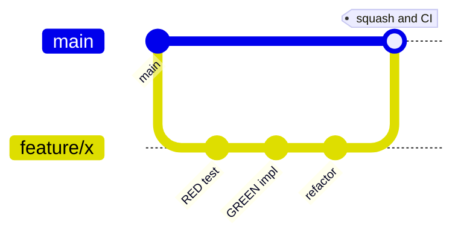

# Getting Started: E128.Reference

> **One sentence:** Install the pinned .NET 11 SDK, then use the repository's deterministic scripts instead of raw `dotnet` commands to build, test, and verify.

*Updated: 2026-11-11T03:24:51Z*

---

## Prerequisites

| Tool                       | Version or note                                                          |
| -------------------------- | ------------------------------------------------------------------------ |
| .NET SDK                   | 11.0.100, pinned in `global.json` with `rollForward: latestPatch`        |
| `rg` (ripgrep)             | required, used by script search paths                                    |
| `fd`                       | required, the file finder the scripts use                                |
| `jq`                       | required, parses script JSON output                                      |
| `bash`                     | 4.0 or later. `scripts/lib.sh` re-execs under Homebrew Bash on macOS 3.2 |
| `shellcheck`               | required for the lint gate                                               |
| Podman                     | optional, only for the container path                                    |
| `jb` (ReSharper CLI)       | optional, `format.sh` runs the semantic cleanup when the tool is present |
| `gitleaks`                 | optional, used by the pre-commit secret scan                             |

Confirm the pinned SDK with `scripts/sdk-version.sh`. Confirm it is installed with `dotnet --list-sdks`.

## Repository Setup

```bash
git clone <repo-url> dotnet-reference
cd dotnet-reference
```

All cross-cutting configuration is inherited from the repository root: `Directory.Build.props`, `Directory.Build.targets`, `Directory.Packages.props`, `.globalconfig`, and `.editorconfig`. No per-project setup is needed.

## Building and Running

> **Use the scripts.** The scripts return terse JSON, and they enforce the Microsoft Testing Platform path. Raw `dotnet test` does not work with this stack.

```bash
scripts/build.sh                  # build the solution, add --verbose for full MSBuild
scripts/build.sh --project Web    # build one project
scripts/test.sh                   # CI-trait tests, the fast path
scripts/test.sh GreeterTests      # one test class
scripts/test.sh --all             # the full suite
scripts/check.sh                  # shell lint, format, build, and test
scripts/ci.sh                     # the full CI pipeline locally
scripts/help.sh                   # every script and its purpose
```

Run the web service and the CLI:

```bash
dotnet run --project src/E128.Reference.Web   # GET /, POST and GET /greetings, GET /health
dotnet run --project src/E128.Reference.Cli   # --name or -n, exit code 0, 1, or 2
scripts/podman.sh                             # build, run, and test the web container
```

## Architecture Quick Reference

```text
├── Directory.Build.props / .targets    # shared MSBuild props, test and analyzer wiring
├── Directory.Packages.props            # Central Package Management pins
├── global.json                         # SDK 11.0.100 and the MTP runner
├── .globalconfig / .editorconfig       # severities and style
├── src/
│   ├── E128.Reference.Core/            # domain library
│   ├── E128.Reference.Web/             # minimal API (Program.cs)
│   ├── E128.Reference.Cli/             # System.CommandLine
│   ├── E128.Analyzers/                 # Roslyn analyzers (netstandard2.0)
│   └── E128.Analyzers.CodeFixers/      # code fixes (netstandard2.0)
├── benchmarks/E128.Benchmarks/         # BenchmarkDotNet
├── tests/                              # five test projects
├── scripts/                            # deterministic bash wrappers
└── .github/workflows/                  # ci.yml and publish.yml
```

## Key Patterns

**Dependency injection with `TimeProvider`**, from `Web/Program.cs`:

```csharp
builder.Services.AddSingleton<Greeter>();
builder.Services.AddSingleton(TimeProvider.System);   // never DateTime.Now, which E128003 reports
builder.Services.AddSingleton<IGreetingRepository, InMemoryGreetingRepository>();
builder.Services.AddSingleton<IGreetingService, GreetingService>();
```

**A union result mapped to an HTTP status**, from the same file:

```csharp
var result = await service.GreetAsync(request, cancellationToken);

return result switch
{
    Greeting greeting => Results.Created(new Uri("/greetings", UriKind.Relative), greeting),
    GreetingError error => Results.BadRequest(error.Message),
    null => Results.Problem("Unknown greeting result.")
};
```

**The CLI maps the same union to an exit code**, 0 for success, 1 for the expected failure, and 2 for the empty case.

**Explicit usings.** Implicit usings are disabled, so every file declares its own `using` directives.

## Development Workflow



1. Branch with `feature/`, `fix/`, or `refactor/`.
2. Follow TDD. Write the failing test first, with an `Assert.Fail` stub. Implement, then refactor.
3. Run `scripts/format.sh --changed`, then `scripts/check.sh`.
4. Squash to one commit and push. CI gates the merge.
5. A change under the analyzer projects also triggers `publish.yml` on merge.
