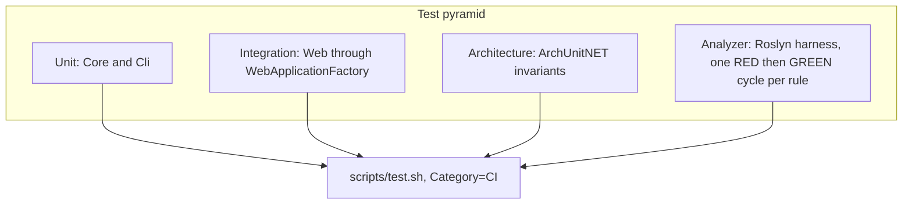

# Testing Strategy: E128.Reference

> **One sentence:** xUnit v3 on the Microsoft Testing Platform, with five test projects that cover unit logic, web integration, architecture invariants, and Roslyn analyzer behavior, all filtered by category trait and gated by deny-by-default analysis.

*Updated: 2026-11-11T03:24:51Z*

---

## Test Projects

| Project                     | What it verifies                    | Notable packages beyond `xunit.v3.mtp-v2`                                  |
| --------------------------- | ----------------------------------- | -------------------------------------------------------------------------- |
| `E128.Reference.Core.Tests` | Core domain logic                   | `Microsoft.Testing.Extensions.TrxReport`, `HangDump`                       |
| `E128.Reference.Cli.Tests`  | CLI invocation and exit codes       | `Microsoft.Testing.Extensions.TrxReport`, `HangDump`                       |
| `E128.Reference.Tests`      | Web endpoints, integration, Podman  | `Microsoft.AspNetCore.Mvc.Testing`                                         |
| `Architecture.Tests`        | Structural invariants over IL       | `TngTech.ArchUnitNET.xUnitV3`                                              |
| `E128.Analyzers.Tests`      | Each analyzer and each code fix     | `Microsoft.CodeAnalysis.CSharp.Analyzer.Testing`, `CodeFix.Testing`        |

All five carry `<IsTestProject>true</IsTestProject>` and inherit the MTP configuration from `Directory.Build.targets`, which sets `UseMicrosoftTestingPlatformRunner` and `OutputType=Exe`. The full suite runs 2655 tests as of 2026-11-11.



## Testing Patterns

**Naming**: `Method_Condition_Result`, for example `Greet_ReturnsGreeting_WithDefaultName`.

**No reflection by default.** Use `internal` plus `InternalsVisibleTo`. The Web project exposes its generated `Program` to the integration test project this way.

**A RED-phase stub** uses `Assert.Fail("message")`. Never use `Assert.True(false, ...)` or `throw new NotImplementedException()`. Analyzer E128171 reports a committed stub whose whole body is `Assert.Fail`.

**Category traits.** Every test method carries `[Trait("Category", "...")]`, which analyzer E128073 enforces.

```csharp
[Fact]
[Trait("Category", "CI")]
public async Task GreetAsync_PersistsGreeting_AndReturnsCreated()
{
    // Arrange, Act, Assert
}
```

**Integration through WebApplicationFactory**:

```csharp
await using var factory = new WebApplicationFactory<Program>();
var client = factory.CreateClient();
var response = await client.GetAsync("/health");
```

**Analyzer tests** use the Roslyn verifier harness, with one test class per rule, for example `E128064DiskRoundtripAnalyzerTests`.

## CI/CD Quality Gates

| Gate                  | Local command                                               | Enforced by                                  |
| --------------------- | ----------------------------------------------------------- | -------------------------------------------- |
| Shell lint            | `scripts/lint-shell.sh`                                     | `ci.yml` `lint` job, pre-commit              |
| Format                | `scripts/format.sh --check`                                 | `ci.yml` `dotnet format --verify-no-changes` |
| Build without warning | `scripts/build.sh`                                          | `TreatWarningsAsErrors=true`                 |
| Deny-by-default rules | during the build                                            | `.globalconfig` blanket `error`              |
| CI tests              | `scripts/test.sh`                                           | `ci.yml` `--filter-trait Category=CI`        |
| Coverage floor        | `scripts/coverage-areas.sh --min-line 80 --min-assembly 80` | `ci.yml` coverage gate                       |
| Architecture          | `scripts/test.sh Architecture.Tests`                        | ArchUnitNET assertions                       |
| Release-file hygiene  | `scripts/internal/analyzer-release-check.sh`                | RS2000 to RS2008                             |
| Secret scan           | `scripts/internal/precommit.sh`                             | gitleaks in CI and pre-commit                |

## Test Categories

| Category | Purpose                               | Runs in CI |
| -------- | ------------------------------------- | ---------- |
| `CI`     | fast, deterministic, no external tool | yes        |
| `Podman` | requires Podman                       | no         |
| `Manual` | requires a manual or external setup   | no         |

## Test Coverage, an Honest Assessment

| Area                  | Coverage posture                                                                                                   |
| --------------------- | ------------------------------------------------------------------------------------------------------------------ |
| `E128.Analyzers`      | High. One RED then GREEN test class per rule is the development norm, and this is the largest test project by far. |
| `E128.Reference.Core` | Adequate for the small surface: Greeter, service, and repository.                                                  |
| `E128.Reference.Web`  | Endpoint-level integration coverage through `WebApplicationFactory`, with one test per reachable result case.      |
| `E128.Reference.Cli`  | Light, but it covers the success path, the alias, and the expected failure exit code.                              |
| Architecture          | Layering, naming, and sealed-by-default invariants are verified over IL.                                           |

Coverage collects in process as Cobertura. The CI gate requires 80 percent line coverage in total and in every measured assembly. `scripts/coverage.sh` reports it locally, and `scripts/coverage-areas.sh` maps it to areas. [code-coverage.md](../../lode/dotnet/code-coverage.md) has the collection model and the gate options.
