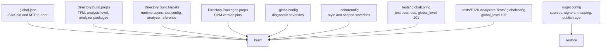

# Configuration: E128.Reference

> **One sentence:** Configuration is build-time first: MSBuild props, `.editorconfig`, and `.globalconfig` govern the solution, and a consumer of the analyzer package tunes rule severities in its own `.globalconfig`.

*Updated: 2026-11-11T03:24:51Z*

---

## Configuration Sources



Precedence runs from the repository file to the more specific file. A higher `global_level` wins, so a test override at level 101 beats the root at level 100, and the analyzer test project at 102 beats both.

## Key MSBuild Properties

`Directory.Build.props` holds the solution-wide settings:

| Property                                 | Value        | Effect                                             |
| ---------------------------------------- | ------------ | -------------------------------------------------- |
| `TargetFramework`                        | `net11.0`    | one target for every project except the analyzers  |
| `LangVersion`                            | `latest`     | the current language band for application code     |
| `Nullable`                               | `enable`     | nullable reference analysis on                     |
| `TreatWarningsAsErrors`                  | `true`       | any warning fails the build                        |
| `ImplicitUsings`                         | `disable`    | every file declares its own `using` directives     |
| `AnalysisLevel`                          | `latest-all` | the latest analyzer rule set                       |
| `AnalysisMode`                           | `All`        | every CA rule runs, including rules off by default |
| `EnableNETAnalyzers`                     | `true`       | the .NET analyzers are active                      |
| `EnforceCodeStyleInBuild`                | `true`       | IDE rules fire during the build                    |
| `ArtifactsPath`                          | `artifacts/` | build output stays out of the project tree         |
| `GenerateDocumentationFile`              | `true`       | XML documentation warnings stay visible            |

`Directory.Packages.props` holds Central Package Management:

| Property                                 | Value   | Effect                                |
| ---------------------------------------- | ------- | ------------------------------------- |
| `ManagePackageVersionsCentrally`         | `true`  | CPM on                                |
| `CentralPackageTransitivePinningEnabled` | `true`  | transitive versions are pinned        |
| `CentralPackageVersionOverrideEnabled`   | `false` | a project cannot override a version   |

`Directory.Build.targets` holds three groups:

- Runtime async for application projects, gated on `net11.0`, `IsRoslynComponent`, `IsTestProject`, and `IsBenchmarkProject`.
- MTP settings for a test project: `UseMicrosoftTestingPlatformRunner` and `OutputType=Exe`.
- The solution-local analyzer reference, with `OutputItemType=Analyzer` and `ReferenceOutputAssembly=false`.

## Severity Configuration

Three files share the work. [analyzers.md](../../lode/dotnet/analyzers.md) has the detail.

| File                                       | Owns                                         | Scope              |
| ------------------------------------------ | -------------------------------------------- | ------------------ |
| `.editorconfig`                            | style, formatting, naming, scoped severities | all projects       |
| `.globalconfig`                            | `dotnet_diagnostic.*` severities             | all projects       |
| `tests/.globalconfig`                      | test relaxations, `global_level` 101         | test projects      |
| `tests/E128.Analyzers.Tests/.globalconfig` | analyzer test relaxations, level 102         | one test project   |

The blanket rule: `.globalconfig` sets `dotnet_analyzer_diagnostic.severity = error`, so every override is explicit.

### Tuning E128.Analyzers as a Consumer

```ini
# .globalconfig in the consuming repository

# Promote a rule to error
dotnet_diagnostic.E128008.severity = error

# Disable a rule
dotnet_diagnostic.E128005.severity = none

# E128062: the minimum reference-assembly band the test suite must use
e128_minimum_framework_version = 100

# E128103: service types whose Add* registration lives in another assembly
e128_registered_services = ITerminal, IPreferenceStore
```

### ConfigureAwait Scoping

```ini
dotnet_diagnostic.CA2007.severity = error
dotnet_code_quality.CA2007.output_kind = DynamicallyLinkedLibrary
```

The setting scopes the rule to library assemblies, so application code does not take `ConfigureAwait`.

## Common Test-Project Overrides

| Rule      | Reason                                                             |
| --------- | ------------------------------------------------------------------ |
| CA2007    | conflicts with xUnit1030, which forbids `ConfigureAwait` in a test |
| MA0004    | the same xUnit1030 conflict                                        |
| VSTHRD111 | the same xUnit1030 conflict                                        |
| CA1707    | test names use `Method_Condition_Result`                           |
| S100      | the same naming form                                               |
| RCS1046   | test names carry no `Async` suffix                                 |
| S4018     | test helpers take explicit type arguments                          |
| E128043   | a guard-clause test must pass `null!`                              |
| MA0191    | the same guard-clause test                                         |
| E128097   | the repository's own suite writes explanatory comments             |
| E128062   | the snippet band is pinned to 100                                  |

## Environment-Specific Overrides

The reference apps carry no per-environment configuration. There is no `appsettings.{Environment}.json` and no connection string. Environment variation lives in CI, which sets `DOTNET_*` flags, and in the container image, whose base tags are pinned to `11.0-resolute`.

## Secrets Compared with Configuration

| Item                     | Classification                                        |
| ------------------------ | ----------------------------------------------------- |
| SDK version, TFM         | configuration, in `global.json` and the props files   |
| Package versions         | configuration, in `Directory.Packages.props`          |
| Rule severities          | configuration, in `.globalconfig` and `.editorconfig` |
| NuGet publish credential | secret, issued through OIDC at publish time only      |
| Application secrets      | none present                                          |
