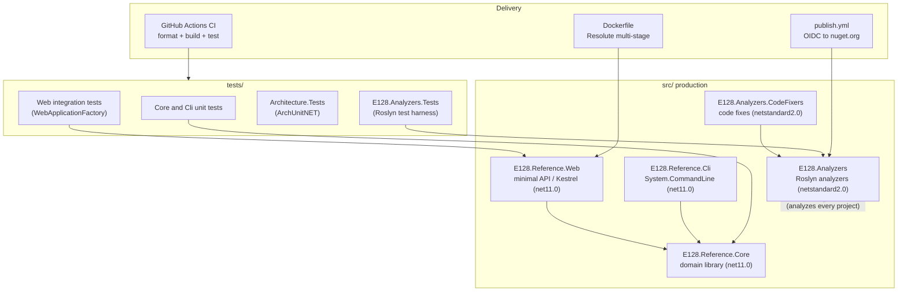

# E128.Reference: Documentation Wiki

> **One sentence:** A .NET 11 reference repository that demonstrates modern conventions end to end: a minimal-API web service, a System.CommandLine CLI, the published E128.Analyzers Roslyn package, deny-by-default code analysis, xUnit v3 on MTP, ArchUnitNET structural tests, and a Claude Code harness.

*Updated: 2026-11-11T03:24:51Z*

---

## Semantic Index: Start Here

| I am a...                  | I want to...                                           | Go to                                                                        |
| -------------------------- | ------------------------------------------------------ | ---------------------------------------------------------------------------- |
| Executive / sponsor        | Understand business value and risk                     | [overview/executive.md](overview/executive.md)                               |
| Architect / staff engineer | See strategic trade-offs and positioning               | [overview/strategy.md](overview/strategy.md)                                 |
| Product manager            | Understand features and user-facing capability         | [overview/product.md](overview/product.md)                                   |
| New engineer               | Build and run the repo locally                         | [engineering/getting-started.md](engineering/getting-started.md)             |
| Engineer (orientation)     | Learn what every project does                          | [engineering/codebase-map.md](engineering/codebase-map.md)                   |
| Systems architect          | Understand the component topology                      | [architecture/system.md](architecture/system.md)                             |
| Backend engineer           | Trace how a request or data flows                      | [architecture/data-flow.md](architecture/data-flow.md)                       |
| Platform / DevOps engineer | Understand CI/CD and publishing                        | [architecture/deployment.md](architecture/deployment.md)                     |
| Security reviewer          | Audit secrets, supply chain, and analyzer safety rules | [architecture/security.md](architecture/security.md)                         |
| Tooling engineer           | Understand the analyzer rule set                       | [architecture/integration-patterns.md](architecture/integration-patterns.md) |
| QA / test engineer         | Understand the test strategy and gates                 | [engineering/testing-strategy.md](engineering/testing-strategy.md)           |
| Anyone configuring it      | Find configuration knobs and severity overrides        | [guides/configuration.md](guides/configuration.md)                           |
| Anyone needing a term      | Look up domain vocabulary                              | [reference/glossary.md](reference/glossary.md)                               |
| CLI user                   | Run the reference CLI and project scripts              | [reference/cli-commands.md](reference/cli-commands.md)                       |

---

## Pyramid Summary

### Level 1: One Sentence

A self-contained .NET 11 reference codebase that proves modern build, test, analysis, and delivery conventions, and that ships the Roslyn analyzer package `E128.Analyzers` to nuget.org.

### Level 2: One Paragraph

E128.Reference is a single-repository, 11-project .NET 11 solution. Three small production projects (a `Core` domain library, a minimal-API `Web` service, and a System.CommandLine `Cli`) show idiomatic application code. A fourth production project, `E128.Analyzers`, is an independently published Roslyn analyzer suite with 214 diagnostic IDs across 207 analyzer classes, measured 2026-11-11, and it enforces the conventions the rest of the repo follows. The solution runs under deny-by-default code analysis with warnings as errors, Central Package Management with transitive pinning, xUnit v3 on the Microsoft Testing Platform, and ArchUnitNET structural invariant tests. Delivery is automated: GitHub Actions runs format, build, and test on every push, then OIDC trusted publishing ships the analyzer package. A portable `AGENTS.md` plus a Claude Code layer of rules, hooks, skills, agents, and bash scripts governs day-to-day development.

### Level 3: Key Capabilities

- **Reference application stack**: a minimal-API web service on Kestrel and a System.CommandLine CLI, both sharing the `Core` library through dependency injection.
- **E128.Analyzers**: the published NuGet package whose source is this repo, a Roslyn analyzer and code-fix suite across eight categories.
- **Deny-by-default analysis**: `.globalconfig` sets every diagnostic to `error`, and each relaxation is explicit and justified.
- **Modern test platform**: xUnit v3 on MTP, category-trait filtering, ArchUnitNET IL-level architecture tests, and a Roslyn analyzer test harness.
- **Central Package Management**: versions pinned in `Directory.Packages.props`, transitive pinning on, NuGet audit at low severity.
- **Hardened containerization**: a multi-stage Resolute Dockerfile, built and run through Podman.
- **Automated delivery**: CI on `ubuntu-26.04` and OIDC trusted publishing with a version-exists gate.
- **AI development harness**: deterministic bash scripts, portable agent rules, 17 agents, and 29 skills.

### Level 4: Architecture at a Glance



### Level 5: Go Deeper

- System topology and layers: [architecture/system.md](architecture/system.md)
- The analyzer suite, which is the flagship: [architecture/integration-patterns.md](architecture/integration-patterns.md)
- Build, run, and contribute: [engineering/getting-started.md](engineering/getting-started.md)
- Every project explained: [engineering/codebase-map.md](engineering/codebase-map.md)
- CI/CD and trusted publishing: [architecture/deployment.md](architecture/deployment.md)

---

## Document Map

```text
docs/
├── index.md                       # you are here (pyramid entry point)
├── overview/
│   ├── executive.md               # Business value, risk, investment
│   ├── strategy.md                # Positioning and trade-offs
│   └── product.md                 # Features, personas, journeys
├── architecture/
│   ├── system.md                  # Component topology and layers
│   ├── data-flow.md               # Request and greeting data flow
│   ├── storage.md                 # State model (in memory) and analyzer metadata
│   ├── deployment.md              # CI/CD, Podman, OIDC publishing
│   ├── integration-patterns.md    # The E128.Analyzers rule catalog
│   └── security.md                # Secrets, supply chain, analyzer safety rules
├── engineering/
│   ├── getting-started.md         # Prerequisites, build, run
│   ├── codebase-map.md            # Project inventory and dependency graph
│   └── testing-strategy.md        # Test projects, patterns, gates
├── guides/
│   └── configuration.md           # Config sources, severity overrides
└── reference/
    ├── glossary.md                # Terminology and acronyms
    └── cli-commands.md            # CLI and scripts reference
```

---

## What Is This?

E128.Reference is a canonical reference implementation owned by the engineering organization. Its purpose is to encode "how we build .NET" into runnable, test-verified, analyzer-enforced code, so that a new service starts from a known-good baseline and an existing service can be measured against it. The one externally consumed artifact is the `E128.Analyzers` NuGet package, which carries the conventions into any consuming codebase as compile-time diagnostics.
