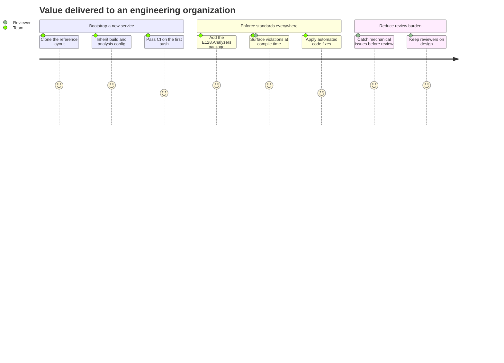

# Executive Overview: E128.Reference

> **One sentence:** A reference codebase that lowers the cost and risk of a new .NET service by encoding engineering standards into runnable, analyzer-enforced code, and that ships those standards as a reusable NuGet package.

*Updated: 2026-11-11T03:24:51Z*

---

## The Problem

Engineering teams re-litigate the same decisions on every new service: which test runner to use, how to manage package versions, how strict to make code analysis, and what "good" .NET looks like. The result is drift. Every repository is subtly different, onboarding is slow, and code review spends its time on mechanical issues instead of design. A convention written in a wiki is ignored because nothing enforces it.

## The Solution

E128.Reference is a single runnable repository that is the standard. It demonstrates the full stack: application code, tests, build configuration, containerization, and CI/CD. It also ships `E128.Analyzers`, a Roslyn analyzer package that turns the conventions into compile-time errors in any consuming codebase. A standard stops being a document and becomes a build failure.

## Business Capabilities

## Technical Architecture in Plain English

The repository holds three small application pieces and two large tooling pieces. The application pieces (a web service, a command-line tool, and a shared library) are deliberately minimal. Their job is to show the right way to wire things up. The tooling pieces are the substance: `E128.Analyzers` and its code-fix companion hold 214 automated checks, most with an automatic fix, that watch for risky or non-idiomatic C# and report it during a build or in the editor. An automated suite of 2655 tests verifies everything, and a merge to `main` ships the package through a trusted publishing pipeline.

## Key Risks and Mitigations

| Risk                                           | Likelihood | Mitigation                                                                      |
| ---------------------------------------------- | ---------- | ------------------------------------------------------------------------------- |
| Standards drift from current .NET guidance     | Medium     | Renovate updates dependencies on a three-day delay; analyzers track Roslyn      |
| An analyzer change breaks consumer builds      | Medium     | Public API tracking, full test suite, version-gated publish                     |
| An SDK rolls to an untested major version      | Low        | `global.json` pins SDK 11.0.100 with `rollForward: latestPatch`                 |
| A secret leaks through the publish pipeline    | Low        | OIDC trusted publishing, so no NuGet API key is stored                          |
| Over-strict analysis blocks legitimate code    | Medium     | Per-rule severity overrides and documented test-project relaxations             |
| A compromised package version enters the build | Low        | Trusted signers, source mapping, a 72 hour minimum publish age, and NuGet audit |

## Compliance Posture

- **No stored credentials**: NuGet publishing uses an OIDC token exchange, not a long-lived key.
- **Supply-chain controls**: Central Package Management with transitive pinning, NuGet audit at low severity, pinned trusted signers, and a 72 hour minimum publish age.
- **FIPS awareness**: analyzer `E128071` flags a non-FIPS hash algorithm, and `E128075` flags non-cryptographic randomness in a security context.
- **Reproducible builds**: a pinned SDK, pinned base images, and GitHub Actions pinned by commit SHA.
- **Secret scanning**: gitleaks runs in CI and in the pre-commit gate.

## Technology Investment Summary

| Investment                             | Rationale                                                                         |
| -------------------------------------- | --------------------------------------------------------------------------------- |
| Custom Roslyn analyzer suite           | Highest leverage: it enforces the standard in every consuming repo, not only here |
| Deny-by-default code analysis          | Catches defects at compile time, the cheapest place to fix them                   |
| xUnit v3 on Microsoft Testing Platform | The supported test path on the current SDK                                        |
| ArchUnitNET architecture tests         | Prevents architectural erosion that a unit test cannot catch                      |
| OIDC trusted publishing                | Removes credential management from the release path                               |
| Claude Code harness                    | Makes the conventions cheap to follow during day-to-day development               |
