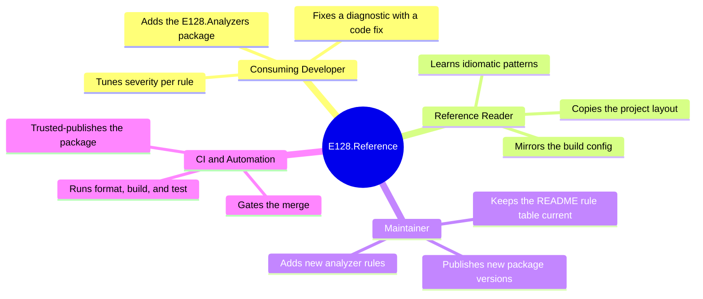
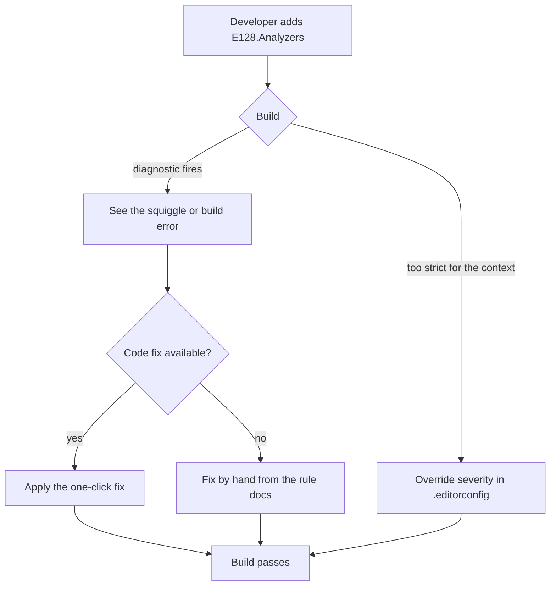
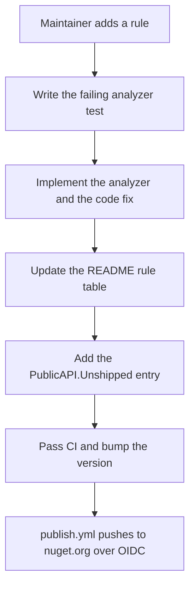

# Product View: E128.Reference

> **One sentence:** The product surface is the analyzer suite that a consuming developer installs, plus a thin reference web and CLI app that shows the patterns those analyzers enforce.

*Updated: 2026-11-11T03:24:51Z*

---

## Personas

## Feature Domains

### Analyzer Rules, the Core Product

| Domain          | Rules | What it enforces                                                          | Example rules                      |
| --------------- | ----- | ------------------------------------------------------------------------- | ---------------------------------- |
| Reliability     | 66    | Regex safety, TOCTOU races, disk round trips, cancellation, JSON lifetime | E128011, E128039, E128056, E128064 |
| Performance     | 54    | O(n²) loops, allocation reduction, frozen collections, handler setup     | E128009, E128027, E128066, E128083 |
| Design          | 34    | Sealed by default, DI correctness, immutability, unit-safe types          | E128005, E128032, E128050, E128061 |
| Security        | 21    | FIPS hashing, cryptographic randomness, unvalidated identity              | E128071, E128075, E128202          |
| Unsafe          | 17    | Pointer and span safety, stack allocation limits                          | E128112, E128120                   |
| Style           | 13    | `string.Empty`, UTF-8 encoding, pragma hygiene, rename artifacts          | E128002, E128006, E128047, E128063 |
| Testing         | 11    | Temp-dir cleanup, current reference assemblies, category traits           | E128054, E128062, E128073          |
| Maintainability | 4     | Complexity ceilings and structural limits                                 | E128152, E128203                   |

The counts are as of 2026-11-11. Full catalog with code-fix status: [../architecture/integration-patterns.md](../architecture/integration-patterns.md).

### Reference Web Service

| Feature         | Surface                                                        |
| --------------- | -------------------------------------------------------------- |
| Greeting        | `GET /` returns a greeting                                     |
| Create greeting | `POST /greetings` returns 201, or 400 for the expected failure |
| List greetings  | `GET /greetings?count=N` returns recent greetings              |
| Health          | `GET /health` returns the health check result                  |

### Reference CLI

| Feature       | Surface                                                              |
| ------------- | -------------------------------------------------------------------- |
| Greet         | `--name` or `-n`, defaulting to "World"                              |
| Exit codes    | 0 success, 1 expected failure, 2 unknown result                      |

## Key User Journeys

## Feature Matrix by Role

| Capability                      | Consuming Dev | Reference Reader | Maintainer | CI  |
| ------------------------------- | ------------- | ---------------- | ---------- | --- |
| Compile-time diagnostics        | Yes           | Yes              | Yes        | Yes |
| One-click code fixes            | Yes           | No               | Yes        | No  |
| Per-rule severity override      | Yes           | Yes              | Yes        | No  |
| Project layout and build config | No            | Yes              | Yes        | Yes |
| Add or modify analyzer rules    | No            | No               | Yes        | No  |
| Publish the package             | No            | No               | Yes, by CI | Yes |

## Supported Systems

| Integration       | Detail                                                               |
| ----------------- | -------------------------------------------------------------------- |
| Roslyn hosts      | Visual Studio 2022 17.8+, Rider 2024.1+, `dotnet build` from the CLI |
| Package registry  | nuget.org, package `E128.Analyzers`                                  |
| CI                | GitHub Actions on `ubuntu-26.04`                                     |
| Container runtime | Resolute .NET 11 images for the web service, built with Podman       |
