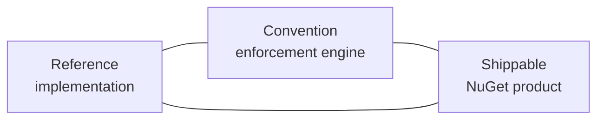

# Strategy and Positioning: E128.Reference

> **One sentence:** The repository's strategic bet is that a convention enforced by tooling beats a convention written in a document, so it invests in a shippable analyzer suite and keeps the application code deliberately thin.

*Updated: 2026-11-11T03:24:51Z*

---

## Strategic Positioning

E128.Reference sits at the intersection of three roles:

- As a **reference implementation**, it shows idiomatic .NET 11: minimal API, System.CommandLine, dependency injection, and immutability.
- As a **convention enforcement engine**, its `.globalconfig`, `Directory.Build.props`, and custom analyzers define and enforce the standard.
- As a **shippable product**, `E128.Analyzers` carries that standard outward to any consuming codebase.

The investment is lopsided on purpose. The analyzer source is about 63k lines, and the application source is a few hundred. The application exists to be analyzed, and the analyzer is the deliverable.

## Key Trade-offs

| Choice                                             | Rationale                                                                     | Alternative considered                               |
| -------------------------------------------------- | ----------------------------------------------------------------------------- | ---------------------------------------------------- |
| Custom analyzers over doc-only conventions         | Compile-time enforcement is unignorable and costs the reviewer nothing        | Wiki guidelines plus manual review (drifts, ignored) |
| Deny-by-default error severity                     | Forces each convention to be met, not aspired to                              | Warning default, which fades into noise              |
| `netstandard2.0` for the analyzer assemblies       | Roslyn loads the one build in the current host and in any newer host          | A `net11.0` build, which closes the older hosts      |
| Single repo with shared build props                | One source of truth for TFM, analysis, and packages                           | Multiple repos, which duplicate and drift            |
| xUnit v3 on MTP                                    | The supported test path on the current SDK                                    | xUnit v2 on VSTest, which is a dead end              |
| Central Package Management with transitive pinning | Removes version drift and surprise transitive upgrades                        | Per-project `Version` attributes                     |
| OIDC trusted publishing                            | Removes a long-lived secret from the release path                             | A stored NuGet API key                               |
| Minimal API over MVC controllers                   | Less ceremony, and it matches current guidance for a small service            | MVC controllers, which add abstraction               |
| Implicit usings disabled                           | Forces an explicit, auditable dependency surface per file                     | Implicit usings, which are terser but implicit       |
| `LangVersion` 14.0 in the analyzer projects        | Keeps the formatter from rewriting source into a C# 15 collection form        | `latest`, which triggers a 26 file rewrite           |

## Competitive Landscape

This is an internal asset, not a market product. `E128.Analyzers` competes for mindshare against established third-party analyzer packages: Meziantou.Analyzer, Roslynator, SonarAnalyzer, and SharpSource. Its differentiation is complementarity, not replacement. The repo runs all of those analyzers alongside its own, and `E128.Analyzers` fills gaps they leave, such as a disk write-then-read round trip, a mid-name underscore rename artifact, an O(n²) loop, and unit safety for `ByteSize` and `TimeSpan`.

## Growth Vectors

- **More analyzer rules**: rule IDs grow monotonically from `E128001` to `E128218` as of 2026-11-11. Each new convention becomes a rule with a test and a README row.
- **Adoption breadth**: every team that adds the package inherits the standard, which multiplies the leverage.
- **Application surface**: the thin Web, Cli, and Core projects can grow to show more patterns as the reference needs expand.
- **Harness maturity**: each new deterministic script reduces friction for the next change.
