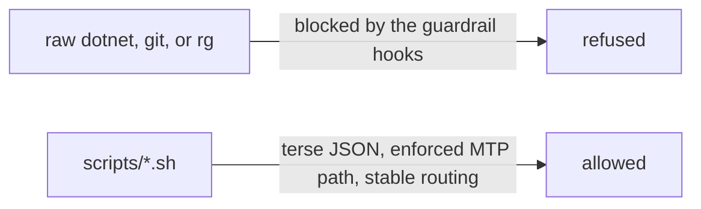

# Command Reference: E128.Reference

> **One sentence:** Day-to-day work goes through deterministic scripts instead of raw `dotnet` or `git` commands, and this page lists the canonical scripts with the common workflows.

*Updated: 2026-11-11T03:24:51Z*

---

## Why Scripts, Not Raw Commands



`scripts/help.sh` lists every script, including the internal set. The repository holds 51 script entries as of 2026-11-11.

## Core Script Table

| Task                  | Script                                                      | Notes                                     |
| --------------------- | ----------------------------------------------------------- | ----------------------------------------- |
| Build                 | `scripts/build.sh [--verbose] [--project NAME] [--errors]`  | terse JSON by default                     |
| Test, one class       | `scripts/test.sh ClassName`                                 | MTP runner, never raw `dotnet test`       |
| Test, full suite      | `scripts/test.sh --all`                                     | includes the Podman and Manual categories |
| Format, apply         | `scripts/format.sh --changed`                               | jb cleanup then `dotnet format`           |
| Format, check         | `scripts/format.sh --check`                                 | verify only                               |
| Composed gate         | `scripts/check.sh`                                          | shell lint, format, build, test           |
| Full CI               | `scripts/ci.sh`                                             | mirrors the `ci` job                      |
| Session context       | `scripts/context.sh`                                        | status, diff, and plans                   |
| Git status            | `scripts/status.sh --json`                                  | structured                                |
| Diff summary          | `scripts/diff.sh --json --staged`                           | structured                                |
| Branch info           | `scripts/branch.sh --json`                                  | ahead, behind, unpushed                   |
| Timestamp             | `scripts/ts.sh`                                             | ISO 8601 UTC                              |
| SDK version           | `scripts/sdk-version.sh`                                    | reads `global.json`                       |
| Analyzer stats        | `scripts/analyzer-stats.sh --json`                          | rule and API counts                       |
| Analyzer context      | `scripts/analyzer-context.sh --json`                        | version, rules, fixes, public API         |
| Codebase stats        | `scripts/codebase-stats.sh --json`                          | files and lines                           |
| Find symbol           | `scripts/find.sh --class`, `--method`, or `--callers NAME`  | deterministic lookup                      |
| File outline          | `scripts/file-outline.sh PATH`                              | structure and line ranges                 |
| Extract source        | `scripts/code-read.sh --method` or `--class NAME PATH`      | one symbol                                |
| Type dependencies     | `scripts/deps.sh TYPE --callers`                            | dependency graph                          |
| Dependency health     | `scripts/dep-check.sh --outdated --vulnerable --json`       | NuGet health                              |
| Podman                | `scripts/podman.sh`                                         | build, run, test the web container        |
| Violation scan        | `scripts/violation-scan.sh`                                 | anti-pattern scan                         |
| Ship                  | `/yeet`                                                     | preflight, commit, push, and pull request |

Internal scripts sit under `scripts/internal/` and are invoked by a skill or an agent. The important ones are `analyzer-release-check.sh`, `analyzer-promote.sh`, `version-bump.sh`, `precommit.sh`, `readme-audit.sh`, and `opencode-agents.sh`.

## Reference Application Commands

| Action          | Command                                                     |
| --------------- | ----------------------------------------------------------- |
| Run the web app | `dotnet run --project src/E128.Reference.Web`               |
| Run the CLI     | `dotnet run --project src/E128.Reference.Cli -- --name Ada` |
| Hit an endpoint | `curl localhost:<port>/`, `/greetings`, `/health`           |

The web app exposes `GET /`, `POST /greetings`, `GET /greetings?count=N`, and `GET /health`. The CLI is a System.CommandLine root command with `--name` or `-n`. It returns exit code 0 for success, 1 for the expected failure of a blank name, and 2 for the empty result case.

## Common Workflows

**1. Make a change, then verify**

```bash
scripts/format.sh --changed
scripts/check.sh
```

**2. Run a targeted test loop on one analyzer**

```bash
scripts/test.sh E128064DiskRoundtripAnalyzerTests   # red
# implement the rule and its fix
scripts/test.sh E128064DiskRoundtripAnalyzerTests   # green
```

**3. Add a new analyzer rule**

```text
write the failing test, then implement the analyzer and the fix
add the README rule row and the PublicAPI.Unshipped entry
add the AnalyzerReleases.Unshipped row
```

```bash
scripts/internal/analyzer-release-check.sh
scripts/internal/version-bump.sh E128.Analyzers
scripts/check.sh
```

**4. Prepare a release**

```bash
scripts/internal/version-bump.sh E128.Analyzers
scripts/internal/analyzer-promote.sh --dry-run
scripts/internal/analyzer-promote.sh
scripts/internal/analyzer-release-check.sh
```

**5. Pre-ship check**

```bash
scripts/ci.sh
```

**6. Inspect the codebase without reading a whole file**

```bash
scripts/find.sh --class GreetingService
scripts/code-read.sh --method GreetAsync src/E128.Reference.Core/Services/GreetingService.cs
scripts/file-outline.sh src/E128.Analyzers/Reliability/DiskRoundtripAnalyzer.cs
```

**7. Audit the README claims**

```bash
scripts/internal/readme-audit.sh --json
```

**8. Build and test the container**

```bash
scripts/podman.sh
```
