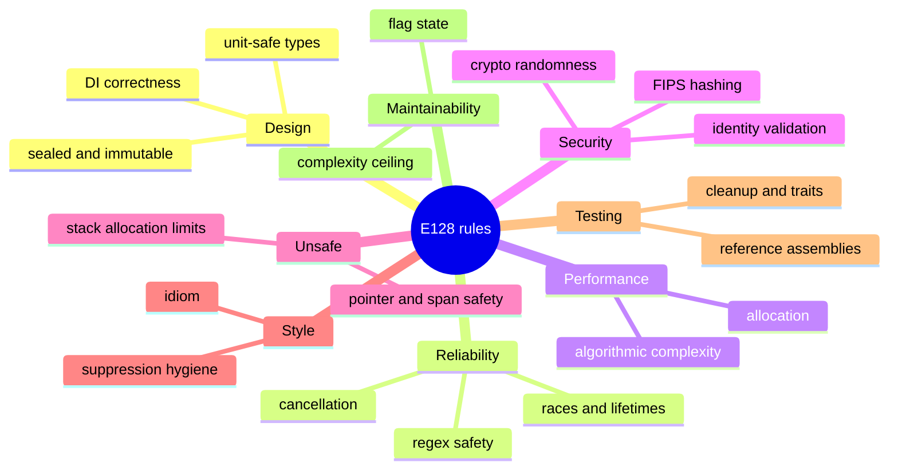

# Glossary: E128.Reference

> **One sentence:** Domain vocabulary and acronyms used across this wiki and the codebase.

*Updated: 2026-11-11T03:24:51Z*

---

## Terminology

| Term                           | Definition                                                                                                              | See also                                                                                                     |
| ------------------------------ | ----------------------------------------------------------------------------------------------------------------------- | ------------------------------------------------------------------------------------------------------------ |
| E128.Reference                 | The reference repository this wiki documents.                                                                           | [../index.md](../index.md)                                                                                   |
| E128.Analyzers                 | The Roslyn analyzer package shipped to nuget.org, and the flagship deliverable of this repository.                      | [../architecture/integration-patterns.md](../architecture/integration-patterns.md)                           |
| Analyzer                       | A .NET compiler extension that reports diagnostics during a build and in the editor.                                    | [../architecture/system.md](../architecture/system.md)                                                       |
| Code fix                       | An automated remediation for a diagnostic, applied in the IDE or through `dotnet format`.                               | [../architecture/integration-patterns.md](../architecture/integration-patterns.md)                           |
| Diagnostic ID                  | A rule identifier such as `E128064`. The numbers grow monotonically.                                                    | [../guides/configuration.md](../guides/configuration.md)                                                     |
| Deny by default                | The policy where every diagnostic is an error and each relaxation is explicit.                                          | [../guides/configuration.md](../guides/configuration.md)                                                     |
| Union result                   | The `GreetingResult` declaration, a `readonly union` of `Greeting` and `GreetingError`. A switch over it is exhaustive. | [../architecture/data-flow.md](../architecture/data-flow.md)                                                 |
| Closed hierarchy               | A type declared `closed`, so a switch over its cases must be exhaustive and a missing case reports `CS8509`.            | [../../lode/dotnet/net11-upgrade.md](../../lode/dotnet/net11-upgrade.md)                                     |
| Runtime async                  | The .NET 11 runtime-supported async model, enabled for application projects through `Features=runtime-async=on`.        | [../../lode/dotnet/net11-upgrade.md](../../lode/dotnet/net11-upgrade.md)                                     |
| Greeter and Greeting           | The trivial domain the Web and Cli apps use to show dependency injection and async patterns.                            | [../architecture/data-flow.md](../architecture/data-flow.md)                                                 |
| Composition root               | The single place that registers services, which is `Program.cs` in the Web app and `CliApp` in the CLI.                 | [../architecture/system.md](../architecture/system.md)                                                       |
| Trusted publishing             | OIDC-based NuGet publishing that exchanges a short-lived token for a publish credential, with no stored key.            | [../architecture/deployment.md](../architecture/deployment.md)                                               |
| PublicAPI tracking             | The `PublicAPI.Shipped.txt` and `PublicAPI.Unshipped.txt` files that gate an analyzer API change.                       | [../architecture/storage.md](../architecture/storage.md)                                                     |
| Release tracking               | The `AnalyzerReleases.Shipped.md` and `AnalyzerReleases.Unshipped.md` files that record which rule shipped when.        | [../architecture/storage.md](../architecture/storage.md)                                                     |
| Minimum publish age            | The `minPublishAgeHours` source setting that delays automatic selection of a newly published package version.           | [../architecture/security.md](../architecture/security.md)                                                   |
| SequentialRenameFixAllProvider | The shared fix-all provider for a rename, used where `BatchFixer` cannot merge two edits to one document.               | [../architecture/integration-patterns.md](../architecture/integration-patterns.md)                           |
| Lode                           | The AI-owned markdown knowledge store under `lode/`, which is the authoritative project memory.                         | [../index.md](../index.md)                                                                                   |
| Deterministic script           | A `scripts/*.sh` wrapper that replaces an ad hoc command and is the canonical path for that operation.                  | [cli-commands.md](cli-commands.md)                                                                           |
| Gate                           | A check that must pass before a commit or a merge, such as `scripts/check.sh` or the CI coverage floor.                 | [../engineering/testing-strategy.md](../engineering/testing-strategy.md)                                     |
| Guardrail hook                 | A Claude Code hook that blocks a raw command and redirects it to a script.                                              | [../../lode/infrastructure/claude-code-maintenance.md](../../lode/infrastructure/claude-code-maintenance.md) |
| Harness                        | The agent rules, hooks, skills, agents, and scripts that drive AI-assisted development in this repo.                    | [../index.md](../index.md)                                                                                   |
| Mirror                         | The generated `.opencode/agents/` copy of the Claude Code agent definitions.                                            | [../engineering/getting-started.md](../engineering/getting-started.md)                                       |

## Acronyms

| Acronym | Expansion                                  | Meaning                                                         |
| ------- | ------------------------------------------ | --------------------------------------------------------------- |
| CPM     | Central Package Management                 | every package version is pinned in `Directory.Packages.props`   |
| MTP     | Microsoft Testing Platform                 | the test runner the repository uses through xUnit v3            |
| TFM     | Target Framework Moniker                   | for example `net11.0` or `netstandard2.0`                       |
| TDD     | Test-Driven Development                    | red, green, refactor                                            |
| DI      | Dependency Injection                       | `Microsoft.Extensions.DependencyInjection` in this repository   |
| OIDC    | OpenID Connect                             | the token protocol behind trusted publishing                    |
| AOT     | Ahead-Of-Time compilation                  | the CLI declares `IsAotCompatible`                              |
| TOCTOU  | Time-Of-Check to Time-Of-Use               | a race class flagged by E128056 and E128064                     |
| ReDoS   | Regular-expression Denial of Service       | a backtracking attack guarded by E128011, E128013, and E128014  |
| FIPS    | Federal Information Processing Standards   | hash-algorithm policy enforced by E128071                       |
| IVT     | `InternalsVisibleTo`                       | exposes internals to a test project instead of using reflection |
| RS      | Roslyn analyzer authoring diagnostics      | the RS-prefixed rules that validate a packaging change          |
| API     | Application Programming Interface          | the HTTP surface of the web project                             |
| IL      | Intermediate Language                      | the compiled form ArchUnitNET analyzes                          |
| PDB     | Program Database                           | the symbol file a coverage collector needs                      |
| LOC     | Lines Of Code                              | the unit of the size reports                                    |
| PII     | Personally Identifiable Information        | the class the pre-commit scan looks for                         |

## Diagnostic Categories

The suite reports in eight categories. A rule's category is the `E128-<Area>` string in its descriptor.

| Category        | Rules | Concern                                                 |
| --------------- | ----- | ------------------------------------------------------- |
| Reliability     | 66    | races, lifetimes, cancellation, regex safety            |
| Performance     | 54    | allocation and algorithmic-complexity reduction         |
| Design          | 34    | sealed, immutable, DI, and unit-safe-type correctness   |
| Security        | 21    | FIPS hashing, cryptographic randomness, identity        |
| Unsafe          | 17    | pointer and span safety, stack allocation limits        |
| Style           | 13    | idiom and suppression hygiene                           |
| Testing         | 11    | cleanup, traits, reference assemblies                   |
| Maintainability | 4     | complexity ceiling and encoded flag state               |

The counts are as of 2026-11-11. `scripts/analyzer-stats.sh` reports the current numbers.
