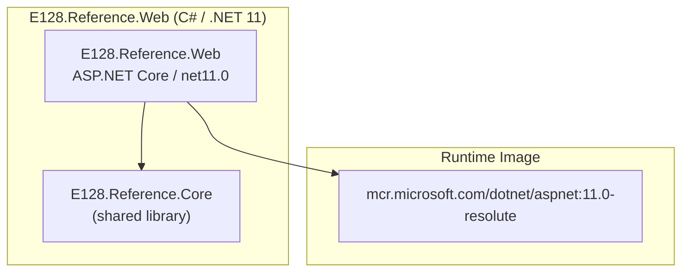

# dotnet-reference Dependency Map
*Updated: 2026-11-10T23:33:05Z*

> Scope: `dotnet-reference` | Scan root: repo root
> Single-repo scan: all sub-projects share one `Directory.Build.props` and `Directory.Packages.props`.

## Project Summary

| Project                   | SDK              | Target          | Role                            | Direct Packages               |
| ------------------------- | ---------------- | --------------- | ------------------------------- | ----------------------------- |
| `E128.Reference.Core`     | `Microsoft.NET.Sdk`     | `net11.0`  | Shared library for Web + Cli    | None                         |
| `E128.Reference.Web`      | `Microsoft.NET.Sdk.Web` | `net11.0`  | ASP.NET Core web service        | None (project ref only)        |
| `E128.Reference.Cli`      | `Microsoft.NET.Sdk`     | `net11.0`  | Console executable              | `System.CommandLine` |
| `E128.Analyzers`          | `Microsoft.NET.Sdk`     | `netstandard2.0` | Roslyn analyzer NuGet package | `Microsoft.CodeAnalysis.CSharp`, `Microsoft.CodeAnalysis.PublicApiAnalyzers` |
| `E128.Analyzers.CodeFixers` | `Microsoft.NET.Sdk`   | `netstandard2.0` | Code fix DLL packed into `E128.Analyzers` | `Microsoft.CodeAnalysis.CSharp.Workspaces` + project ref to `E128.Analyzers` |

All production projects also receive the following **analyzer packages** via `Directory.Build.props`
(`PrivateAssets="all"`, compile-time only, not shipped to consumers). Versions are pinned
centrally in `Directory.Packages.props`:

| Analyzer Package                                |
| ----------------------------------------------- |
| `AsyncFixer`                                    |
| `IDisposableAnalyzers`                          |
| `Meziantou.Analyzer`                            |
| `Microsoft.CodeAnalysis.CSharp.CodeStyle`       |
| `Microsoft.VisualStudio.Threading.Analyzers`    |
| `Roslynator.Analyzers`                          |
| `Roslynator.CodeAnalysis.Analyzers`             |
| `Roslynator.Formatting.Analyzers`               |
| `SharpSource`                                   |
| `SonarAnalyzer.CSharp`                          |

## Cross-Project Dependency Heat Map

### External Service Dependencies

None. This repo has no client packages referencing external services.

### Infrastructure

None detected. No appsettings.json, connection strings, or infra config files present.

### Runtime Images

| Base image                              | Tag            | Type         |
| --------------------------------------- | -------------- | ------------ |
| `mcr.microsoft.com/dotnet/aspnet`       | `11.0-resolute`   | .NET runtime (production, E128.Reference.Web) |
| `mcr.microsoft.com/dotnet/sdk`          | `11.0-resolute`   | .NET SDK (restore + build stages)             |

> Tags are pinned to a minor version (`:11.0-resolute`), not a digest. They drift with
> patch releases but do not track `:latest`. No unpinned tags.

Release builds set `ReadyToRun` true, so the container carries precompiled
images and gains a CPU floor. On Linux, .NET 11 compiles ReadyToRun against the
`x86-64-v3` target. A host below that target cannot run the image.

---

## Runtime & SDK Versions

| Artifact              | Value                                      | Source                                |
| --------------------- | ------------------------------------------ | ------------------------------------- |
| Runtime image         | `mcr.microsoft.com/dotnet/aspnet:11.0-resolute`  | `Dockerfile` (final `runtime` stage) |
| SDK/build image       | `mcr.microsoft.com/dotnet/sdk:11.0-resolute`     | `Dockerfile` (`restore`/`build` stages) |
| .NET SDK pin          | see `global.json`                          | `global.json`                         |
| SDK rollForward       | `latestPatch`                             | `global.json` (pins the SDK to the `11.0.1xx` line) |
| Target framework      | `net11.0` (all except `E128.Analyzers`)    | `Directory.Build.props`               |
| Analyzers TF          | `netstandard2.0`                           | `E128.Analyzers.csproj`               |
| CI SDK version        | `11.0.x`                                   | `.github/workflows/ci.yml` `setup-dotnet` |
| CI platform           | `ubuntu-26.04`                             | `.github/workflows/ci.yml`            |
| Secret scanner        | gitleaks, version and SHA-256 pinned in job `env` | `.github/workflows/ci.yml` (`lint` job) |
| Test runner           | Microsoft.Testing.Platform                 | `global.json`                         |

> `rollForward: "latestPatch"` in `global.json` pins the SDK to the `11.0.1xx`
> line. A major SDK bump needs a manual edit of `global.json`.

---

## Per-Project Details

### E128.Reference.Core

**Role:** Shared domain library. No direct package dependencies. It inherits analyzers
from `Directory.Build.props`. Referenced by Web and Cli via project reference.

### E128.Reference.Web

**Role:** ASP.NET Core web application (`Microsoft.NET.Sdk.Web`). References
`E128.Reference.Core` via project reference. The full Core domain (Greeter,
GreetingService, IGreetingRepository, InMemoryGreetingRepository) is wired into DI.
Exposes `GET /`, `POST /greetings`, `GET /greetings`, and `/health` (via
`AddHealthChecks` middleware). Built and shipped via the multi-stage `Dockerfile`.

#### Service Layer Diagram

### E128.Reference.Cli

**Role:** Console executable using `System.CommandLine`. References `E128.Reference.Core`.
Constructs `Greeter` directly, because one stateless service needs no container.

#### Key Packages

Versions are pinned centrally in `Directory.Packages.props`.

| Package                             | Role                 |
| ----------------------------------- | -------------------- |
| `System.CommandLine`                | CLI argument parsing |

### E128.Analyzers

**Role:** Roslyn analyzer NuGet package published to nuget.org as `E128.Analyzers`.
Targets `netstandard2.0` for maximum Roslyn host compatibility. Packaging is handled
by `publish.yml` via OIDC trusted publishing.

#### Key Packages

Versions are pinned centrally in `Directory.Packages.props`.

| Package                                        | Role                                     |
| ---------------------------------------------- | ---------------------------------------- |
| `Microsoft.CodeAnalysis.CSharp`                | Roslyn syntax/semantic analysis APIs     |
| `Microsoft.CodeAnalysis.PublicApiAnalyzers`    | API tracking via PublicAPI.Shipped/Unshipped.txt (PrivateAssets=all) |
| `PolySharp`                                    | netstandard2.0 polyfill for nullable attributes (PrivateAssets=all) |

#### E128.Analyzers.CodeFixers

**Role:** Code fix providers in a separate assembly. RS1038 forbids one assembly
from carrying both analyzers and fix providers. `dotnet pack` on `E128.Analyzers`
builds this project first and places both DLLs under `analyzers/dotnet/cs` in the
package. Fix providers extend the shared base class `E128CodeFixProviderBase`
and use `UsingDirectives.AddIfMissing` for using-directive insertion. The package
reference stays `Microsoft.CodeAnalysis.CSharp.Workspaces`.

#### Publishing

- Packaged via `dotnet pack`, pushed via `dotnet nuget push`
- OIDC-based API key exchange (no stored secrets)
- Triggered by pushes to `src/E128.Analyzers/**` on `main`
- Version check gates the push (skips if version already on nuget.org)

---

## Test Stack (test projects, excluded from production tables)

Versions are pinned centrally in `Directory.Packages.props`.

| Package                                          | Role                              |
| ------------------------------------------------ | --------------------------------- |
| `xunit.v3.mtp-v2`                                | xUnit v3 with MTP runner          |
| `TngTech.ArchUnitNET.xUnitV3`                    | Architecture invariant tests      |
| `Microsoft.CodeAnalysis.CSharp.Analyzer.Testing` | Roslyn analyzer test harness      |
| `Microsoft.CodeAnalysis.CSharp.CodeFix.Testing`  | Roslyn code fix test harness      |
| `Microsoft.AspNetCore.Mvc.Testing`               | Integration test web host         |
| `Microsoft.Testing.Extensions.HangDump`          | Hang detection in CI              |
| `Microsoft.Testing.Extensions.TrxReport`         | TRX report output                 |
| `Microsoft.Testing.Extensions.CodeCoverage`      | In-process Cobertura coverage     |

---

## Benchmark Project (excluded from production tables)

`benchmarks/E128.Benchmarks` is an executable. It references `E128.Analyzers`, `E128.Reference.Core`, and `E128.Reference.Web`. Versions are pinned centrally in `Directory.Packages.props`. See [benchmarks.md](../dotnet/benchmarks.md).

| Package                            | Role                                            |
| ---------------------------------- | ----------------------------------------------- |
| `BenchmarkDotNet`                  | Benchmark runner and memory diagnoser           |
| `Microsoft.AspNetCore.Mvc.Testing` | In-process host for the web endpoint benchmarks |
| `Microsoft.CodeAnalysis.CSharp`    | Compilation for the analyzer benchmarks         |

---

## Central Package Management

Versions are pinned in `Directory.Packages.props` (CPM). All projects use
`ManagePackageVersionsCentrally=true`. Transitive pins are enabled
(`CentralPackageTransitivePinningEnabled=true`). A setup-owned block in the first
`PropertyGroup` of `Directory.Packages.props` sets the transitive pin and version override
properties. NuGet audit is active at `low`
severity for all deps (direct and transitive).
