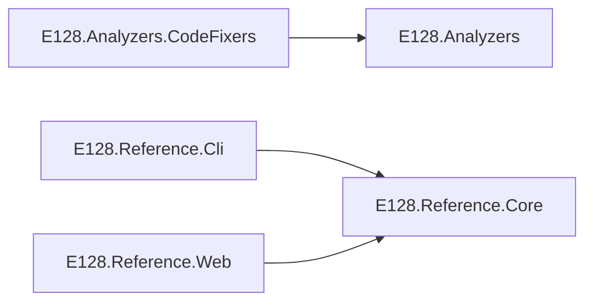

# Architecture Testing
*Updated: 2026-11-18T09:06:47Z*

## Overview

`tests/Architecture.Tests/` uses [TngTech.ArchUnitNET](https://github.com/TngTech/ArchUnitNET) to enforce structural invariants at the assembly and namespace level. Tests run in the CI suite through xUnit v3 and analyze compiled IL using Mono.Cecil.

## Package

- `TngTech.ArchUnitNET.xUnitV3`: xUnit v3 integration (includes core and assertions). Version pinned in `Directory.Packages.props`.

The test project references every production project under `src/`. Two models exist:

- `ArchitectureBaseline` loads only the Core assembly (`typeof(Greeter).Assembly`). The layer, naming, sealed, and service rules use it.
- `ProjectReferenceBaseline` loads every production assembly by name. `ProjectBoundaryTests` uses it.

A `ProjectReference` without a loaded assembly is dead weight (`/prune-deps` flags it).

## How It Works

ArchUnitNET loads compiled assemblies via Mono.Cecil and builds an in-memory architecture model (`ArchUnitNET.Domain.Architecture`). Tests define rules using a fluent API and check them against the model. Failures throw `FailedArchRuleException`, which xUnit reports as test failures.

### Architecture Baseline

`ArchitectureBaseline.cs` loads the Core assembly once per test run (static field). All test classes reference this shared instance to avoid repeated IL parsing.

```csharp
public static readonly Architecture Instance =
    new ArchLoader()
        .LoadAssemblies(typeof(Greeter).Assembly)
        .Build();
```

### Fluent Rule API

Rules are defined using `ArchRuleDefinition` static methods:

```csharp
using static ArchUnitNET.Fluent.ArchRuleDefinition;

IArchRule rule = Types()
    .That().ResideInNamespace("E128.Reference.Core.Models")
    .Should().NotDependOnAny(
        Types().That().ResideInNamespace("E128.Reference.Core.Services"));

rule.Check(Architecture);
```

## Current Rules

### Layer Dependencies (`LayerDependencyTests`)

Enforces dependency direction: Models depend on nothing, Services depend on Models and Repositories, Repositories depend on Models.

- Models must not depend on Services
- Models must not depend on Repositories
- Repositories must not depend on Services

### Naming Conventions (`NamingConventionTests`)

- Interfaces must start with "I"
- Concrete classes must not use interface naming pattern (`I[A-Z][a-z]...`)

### Sealed Classes (`SealedClassTests`)

- All non-abstract classes must be sealed (project convention to favor immutability)

### Service Patterns (`ServicePatternTests`)

- Service classes (in `Services` namespace) must implement `IGreetingService`
- Service classes must have "Service" suffix
- Repository classes (in `Repositories` namespace) must implement `IGreetingRepository`

### Project Boundaries (`ProjectBoundaryTests`)

Each production assembly has one rule. The rule forbids a dependency on a production assembly outside the transitive `ProjectReference` closure of the project. An analyzer reference with `ReferenceOutputAssembly="false"` is not a compile reference, so it is not in the closure.



The allowed graph is a literal baseline. The tests never compute it from the current graph. A type dependency on an assembly outside the baseline closure fails a rule until a reviewer updates the baseline. A new `ProjectReference` without a type dependency does not fail a rule. Compare the evaluated graph with the baseline when a project or reference file changes.

### Project Inventory (`ProjectInventoryTests`)

These tests keep the boundary baseline complete. They hold two frozen literal lists: the expected production assemblies and the expected boundary rule names. The lists stay separate from `ProjectReferenceBaseline` and `ProjectBoundaryTests`, which they verify.

- `ProjectReferenceBaseline` loads exactly the expected assemblies.
- Each expected assembly loads and contains types.
- `ProjectBoundaryTests` has one rule for each expected subject.

The inventory checks snapshot consistency. It does not discover a new project. A new production project needs a reviewer to update the inventory, the baseline, and the rules together.

Coverage instrumentation injects a tracker type with one full name into each instrumented assembly. ArchUnitNET merges that type across assemblies, so the rules exclude the `Microsoft.CodeCoverage.Instrumentation.Static.Tracker` namespace. Without the exclusion, `scripts/coverage.sh` fails the boundary rules.

## Adding New Rules

1. Create a new test class in `tests/Architecture.Tests/`
2. Reference `ArchitectureBaseline.Instance`, or `ProjectReferenceBaseline.Instance` for a rule across assemblies
3. Define rules using `ArchRuleDefinition` fluent API
4. Tag with `[Trait("Category", "CI")]`
5. If analyzing additional assemblies, add a `ProjectReference` to the target project **and** load its assembly in `ArchitectureBaseline`

## Key Namespaces

| Using                                          | Purpose                                |
| ---------------------------------------------- | -------------------------------------- |
| `ArchUnitNET.Fluent`                           | `IArchRule` and fluent builders        |
| `ArchUnitNET.xUnitV3`                          | `.Check()` extension for xUnit         |
| `static ArchUnitNET.Fluent.ArchRuleDefinition` | `Types()`, `Classes()`, `Interfaces()` |
| `ArchUnitNET.Loader`                           | `ArchLoader` for IL loading            |
| `ArchUnitNET.Domain`                           | `Architecture` model type              |

## Related

- [Testing](testing.md)
- [Project Structure](project-structure.md)
- [Analyzers](analyzers.md)
