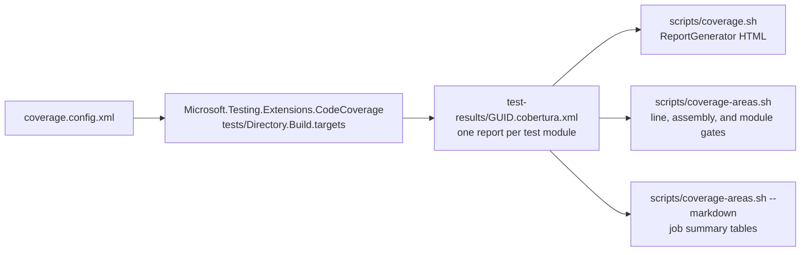

# Code Coverage
*Updated: 2026-11-10T14:10:59Z*

Coverage collects in process through the Microsoft.Testing.Platform extension.
The CI gate requires 80 percent line coverage in total and in every measured
assembly.

## Architecture



## Collection

`tests/Directory.Build.targets` imports the root targets and adds the coverage
package to every `IsTestProject`. The extension loads inside the test process,
so it needs no profiler attach step.

`scripts/coverage.sh` builds the solution and runs:

```bash
dotnet test --solution E128.Reference.slnx \
  --no-build \
  --filter-trait "Category=CI" \
  --coverage \
  --coverage-output-format cobertura \
  --coverage-settings coverage.config.xml \
  --results-directory ./test-results
```

The extension writes one GUID-named Cobertura file per test module. Consumers
read the whole `test-results` directory, then merge classes across reports.

CI builds Release to validate that configuration. That validation build runs
with `ReadyToRun=false`, because it discards the precompiled images. CI then
builds Debug and runs the coverage pass in Debug. This avoids the ReadyToRun
images that stall the analyzer test host under instrumentation.

## Instrumentation Contracts

- `CollectAspDotNet` is `True`. `WebApplicationFactory` runs the ASP.NET Core
  host in process, and the engine skips that host without the flag.
- `CompilerGeneratedAttribute` stays measured. The minimal API endpoints are
  lambdas in top-level statements, so excluding that attribute removes the
  whole `E128.Reference.Web` assembly.
- `GeneratedCodeAttribute` stays excluded. It removes the untestable top-level
  builder and host boilerplate.
- The extension writes one report per module. A fixed output name makes modules
  overwrite each other, so the scripts read a glob.

## Coverage Scope

`coverage.config.xml` holds an `Exclude` list and no `Include` list. Every
loaded assembly with a PDB is measured, except the test assemblies. A new
project joins the measured set when it is created.

Measured assemblies:

- `E128.Analyzers`
- `E128.Analyzers.CodeFixers`
- `E128.Reference.Core`
- `E128.Reference.Cli`
- `E128.Reference.Web`

`scripts/coverage-areas.sh` treats a measured assembly that is absent from the
reports as a gate failure.

## Gate

CI runs:

```bash
bash scripts/coverage-areas.sh --min-line 80 --min-assembly 80
```

The gate fails in four cases:

1. Total line coverage is below the floor.
2. Any measured assembly is below the assembly floor.
3. Any expected module is absent from the reports.
4. The reports hold no line data.

`--min-line 0` and `--min-assembly 0` disable the two floors. `--namespace`
checks one namespace for any line or branch gap. `--source-file` checks one
source file and exits 1 when no class matches or the file is below the floor.
`--self-test` proves the gate against its fixtures.

## Feature Areas

`coverage-areas.json` maps an assembly name or a namespace prefix to a feature
area. A longer matching key wins. Areas:

| Area | Match |
|------|-------|
| Analyzers | `E128.Analyzers` |
| Code Fixers | `E128.Analyzers.CodeFixers` |
| Reference Core | `E128.Reference.Core` |
| Reference CLI | `E128.Reference.Cli` |
| Reference Web | `E128.Reference.Web` |

Classes that match no key land in the Unmapped bucket.

## Baseline

Measured 2026-11-07 over five module reports. Classes merge across reports, and
each line keeps its highest hit count. Total: 29276 of 34036 lines, 86.01
percent.

| Assembly | Lines | Line |
|----------|-------|------|
| E128.Analyzers | 22021/25188 | 87.43% |
| E128.Analyzers.CodeFixers | 7166/8758 | 81.82% |
| E128.Reference.Cli | 22/23 | 95.65% |
| E128.Reference.Core | 43/43 | 100.0% |
| E128.Reference.Web | 24/24 | 100.0% |

The Code Fixers assembly sits closest to the floor.

## Local Setup

```bash
dotnet tool install --global dotnet-reportgenerator-globaltool
```

```bash
bash scripts/coverage.sh                         # Run and open the HTML report
bash scripts/coverage.sh --no-open               # Generate without opening
bash scripts/coverage.sh --configuration Release # Collect from a Release build
bash scripts/coverage.sh --json                  # Totals as JSON
bash scripts/coverage-areas.sh --min-line 80 --min-assembly 80
bash scripts/coverage-areas.sh --source-file Greeter.cs --min-line 80
bash scripts/coverage-areas.sh --self-test
```

## See Also

- [Testing](testing.md)
- [Architecture Testing](architecture-testing.md)
- [Test Patterns](test-patterns.md)
