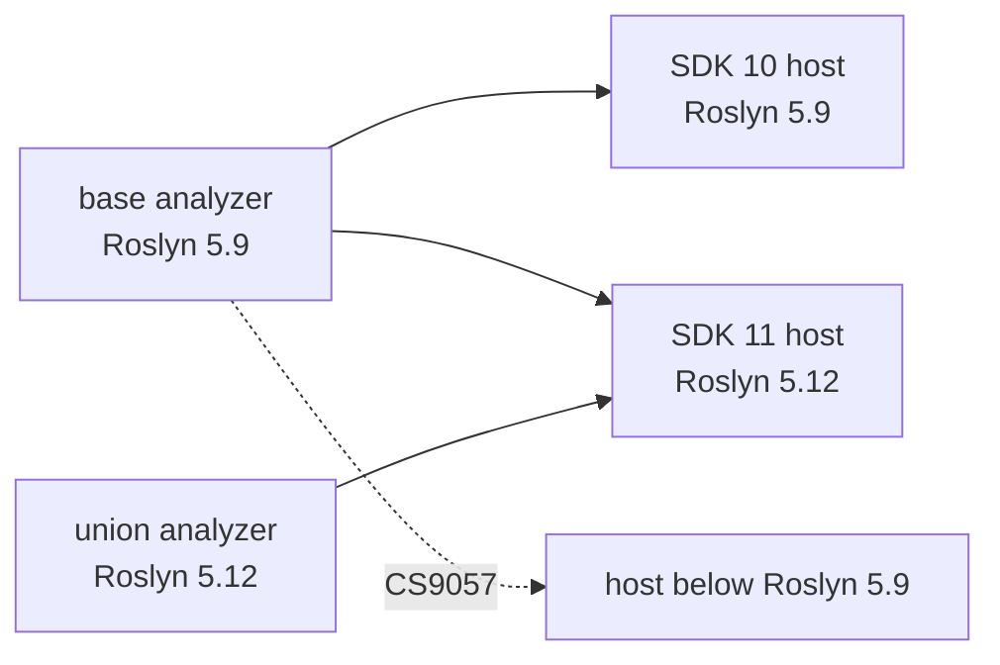

# .NET 11 Upgrade Practices
*Updated: 2026-11-24T12:57:59Z*

Rules this repository follows on the `net11.0` band. Each rule came from a probe
on the GA SDK. See [project-structure.md](project-structure.md)
for the solution shape and [analyzers/package-layout.md](analyzers/package-layout.md)
for the published package layout.

## One SDK Root

The repository builds and tests on SDK `11.0.1xx` only. A second SDK root can
sit on the same machine, and the shell may resolve it first.

A non-interactive shell can resolve an older root first. A script that then
reads a `global.json` pinned to the new band fails SDK resolution with a
"SDK not found" message. Put the root that carries the pinned band first, or
call that binary by absolute path.

## One Framework For This Repository

`Directory.Build.props` defaults projects to `net11.0`. The analyzer assemblies
override it to `netstandard2.0`. The analyzer test project is not multi-targeted.

Two rules follow:

1. Do not pass a TFM override on the command line. A global `TargetFramework` or
   `TargetFrameworks` property leaks into project references and breaks the
   `netstandard2.0` restore of the analyzer projects.
2. The analyzer test project carries one framework. Do not add a second leg.

## Analyzer Reach

The base analyzer assemblies target `netstandard2.0` and compile against
Roslyn 5.9, so a .NET SDK 10.0 host loads them. The union assembly compiles
against Roslyn 5.12 and ships in the 5.12 folder only. The repository tests the
rules in a `net11.0` host and proves the 5.9 band through the package layout.
Four rules hold that shape:

1. The base and fixer builds reference `Microsoft.CodeAnalysis` 5.9.0.0. The
   union build references 5.12.0.0. Roslyn loads an assembly built on an older
   band into a host on that band or above. It never loads one into an older
   host.
2. `Directory.Packages.props` keeps the 5.12.0 pin and gives the base and fixer
   projects a conditional 5.9.0 pin. NuGet publishes the pin behind the SDK
   compiler and not with it, so the pin can lag the SDK band. Check the package
   index before a bump. See [dependency-policy.md](../dependency-policy.md).
3. The analyzer projects pin `LangVersion` to `14.0`. The reason is the
   formatter, not an older compiler. On `latest` it rewrites a collection
   initializer with a constructor argument into the C# 15 collection
   expression argument form, and that edit touches every analyzer file.
4. A test-only Roslyn package may move to the SDK 11 band, because it never
   ships.



The SDK picks one analyzer folder per package. The base build therefore ships
in both folders, and the union build ships in the 5.12 folder only. E128220 and
E128221 are absent on a 5.9 host, which costs nothing because that compiler
cannot parse union syntax.

A consumer below Roslyn 5.9 sees CS9057, one diagnostic per project, and no
rule runs. The package ships `build/E128.Analyzers.targets` to report that
condition once as `E128PKG0001`. See
[analyzers/package-layout.md](analyzers/package-layout.md).

## Union Results

`union` is GA syntax. It compiles at the default language version and needs no
preview flag.

```csharp
public union GreetingResult(Greeting, GreetingError);
```

A case type converts to the union implicitly, and a switch expression matches
the case types.

`where T : union` does not compile (`CS0246`). Constrain the helper on
`IUnion` instead. The compiler then rejects a non-union type argument with
`CS0315.`

```csharp
public static TOut Match<TUnion, TOut>(this TUnion value, Func<TUnion, TOut> match)
    where TUnion : IUnion;
```

`IUnion` exposes one member, `Value`. A hand-written type can satisfy it, so a
helper that reads the case list must prove the list stays closed.

End a union `switch` with a `null` arm. A `_` or `var` arm accepts any case type
added later, so the compiler can no longer warn about it. A switch statement
that omits a case reports nothing at all, so the missing-case check needs a
switch expression. Two parse facts hold in a statement over a union governing
type: `case _` parses `_` as a case-type identifier and fails with `CS0103`,
and `case var _:` is the catch-all that compiles.

`SS019` demands a `default` label on every switch, which a union switch must
not have. Each file that switches over a union takes its own scoped `SS019`
section in `.editorconfig`. A separate section relaxes the four declaration rules
for the union declaration file.

## Closed Hierarchies

A `closed` type makes a switch exhaustive. A missing case reports `CS8509` in a
switch expression, which `TreatWarningsAsErrors` turns into a build failure. Do
not mark a closed type `abstract`, because the compiler rejects it with
`CS9384`. The `closed` modifier alone implies abstract: the compiler rejects
`new` on a closed class with `CS0144`. A leaf under a closed base needs no
modifier to build, so `sealed` on
each leaf is a convention the review enforces rather than the compiler.

## Runtime Async

Runtime async stays opt-in. A `net11.0` project no longer needs
`EnablePreviewFeatures` for it.

```xml
<PropertyGroup Condition="'$(TargetFramework)' == 'net11.0' and '$(IsRoslynComponent)' != 'true' and '$(IsTestProject)' != 'true' and '$(IsBenchmarkProject)' != 'true'">
  <Features>$(Features);runtime-async=on</Features>
</PropertyGroup>
```

The group belongs in `Directory.Build.targets`. A `.props` group evaluates
before the project body sets `IsTestProject`, `IsRoslynComponent`, or a similar
role marker, so a `.props` condition reads them as empty and matches too much.

Never apply the switch to a `netstandard2.0` analyzer.
`<UseRuntimeAsync>false</UseRuntimeAsync>` opts one project out. The absence of
`[AsyncStateMachine]` on a method detects the switch.

## Formatting Hazard

`scripts/format.sh` runs `jb cleanupcode` over the whole solution. On a new SDK
band that tool rewrites far more than the reported findings. Pass `--no-jb`
with an explicit file list, then fix only what the check reports.

One rewrite is unsafe. The formatter turns `new SyntaxList<StatementSyntax>(body)`
into `[with(body)]`, which fails with `CS9359`. Use `SyntaxFactory.SingletonList`
for that shape.

## Verification

Run these in order, and name the SDK band for each:

1. `scripts/runtime-matrix.sh --json` reports the pin and the framework set.
2. `scripts/build.sh --warnings` reports zero warnings and zero errors.
3. `scripts/format.sh --check` reports no finding.
4. `scripts/test.sh --all` reports the suite count.

## See Also

- [project-structure.md](project-structure.md): solution layout, CPM, props
- [analyzers/package-layout.md](analyzers/package-layout.md): shipped package layout
- [../dotnet-reference/dep-map.md](../dotnet-reference/dep-map.md): pinned versions and images
