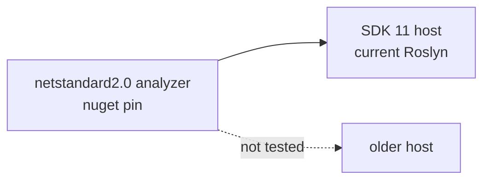

# .NET 11 Upgrade Practices
*Updated: 2026-11-11T03:20:00Z*

Rules this repository follows on the `net11.0` band. Each rule came from a probe
on the GA SDK. See [project-structure.md](project-structure.md)
for the solution shape and [analyzers/package-layout.md](analyzers/package-layout.md)
for the published package layout.

## One SDK Root

The repository builds and tests on SDK `11.0.1xx` only. A second SDK root can
sit on the same machine, and the shell may resolve it first.

A non-interactive shell can resolve an older root first. A script that then
reads a `global.json` pinned to the new band fails SDK resolution with a
"SDK not found" message. Put the root that carries the pinned band first, or
call that binary by absolute path.

## One Framework For This Repository

Every project targets `net11.0`, and the repository builds and tests on that one
band. The analyzer test project is not multi-targeted.

Two rules follow:

1. Do not pass a TFM override on the command line. A global `TargetFramework` or
   `TargetFrameworks` property leaks into project references and breaks the
   `netstandard2.0` restore of the analyzer projects.
2. The analyzer test project carries one framework. Do not add a second leg.

## Analyzer Reach

The analyzer support window is `net11.0`. Both analyzer assemblies stay
`netstandard2.0`, and the repository proves the package only in a `net11.0`
host. Three rules hold that shape:

1. Both analyzer assemblies target `netstandard2.0`. Roslyn loads an analyzer
   built on an older Roslyn band forward, never backward.
2. The shipped `Microsoft.CodeAnalysis.CSharp` pin follows the current release
   on nuget.org. NuGet publishes that pin behind the SDK compiler and not with
   it, so the pin can lag the SDK band until a suitable release appears. Check
   the package index before a bump. See
   [dependency-policy.md](../dependency-policy.md).
3. Both analyzer projects pin `LangVersion` to `14.0`. The reason is the
   formatter, not an older compiler. On `latest` it rewrites a collection
   initializer with a constructor argument into the C# 15 collection
   expression argument form, and that edit touches every analyzer file.
4. A test-only Roslyn package may move to the SDK 11 band, because it never
   ships.



The package still loads in an older host, because Roslyn loads it forward. The
repository does not claim or test that reach. The build proves that the package
assembles, and the suite proves that each rule runs in the current host.

## Union Results

`union` is GA syntax. It compiles at the default language version and needs no
preview flag.

```csharp
public union GreetingResult(Greeting, GreetingError);
```

A case type converts to the union implicitly, and a switch expression matches
the case types.

`where T : union` does not compile (`CS0246`). Constrain the helper on
`IUnion` instead. The compiler then rejects a non-union type argument with
`CS0315.`

```csharp
public static TOut Match<TUnion, TOut>(this TUnion value, Func<TUnion, TOut> match)
    where TUnion : IUnion;
```

`IUnion` exposes one member, `Value`. A hand-written type can satisfy it, so a
helper that reads the case list must prove the list stays closed.

End a union `switch` with a `null` arm. A `_` or `var` arm accepts any case type
added later, so the compiler can no longer warn about it. A switch statement
that omits a case reports nothing at all, so the missing-case check needs a
switch expression.

`SS019` demands a `default` label on every switch, which a union switch must
not have. The files that switch over a union take a scoped `SS019` row in
`.editorconfig`, in the same block that relaxes the four declaration rules.

## Closed Hierarchies

A `closed` type makes a switch exhaustive. A missing case reports `CS8509` in a
switch expression, which `TreatWarningsAsErrors` turns into a build failure. Do
not mark a closed type `abstract`, because the compiler rejects it with
`CS9384`. A leaf under a closed base needs no modifier to build, so `sealed` on
each leaf is a convention the review enforces rather than the compiler.

## Runtime Async

Runtime async stays opt-in. A `net11.0` project no longer needs
`EnablePreviewFeatures` for it.

```xml
<PropertyGroup Condition="'$(TargetFramework)' == 'net11.0' and '$(IsRoslynComponent)' != 'true' and '$(IsTestProject)' != 'true' and '$(IsBenchmarkProject)' != 'true'">
  <Features>$(Features);runtime-async=on</Features>
</PropertyGroup>
```

The group belongs in `Directory.Build.targets`. A `.props` group evaluates
before the project body sets `IsTestProject`, `IsRoslynComponent`, or a similar
role marker, so a `.props` condition reads them as empty and matches too much.

Never apply the switch to a `netstandard2.0` analyzer.
`<UseRuntimeAsync>false</UseRuntimeAsync>` opts one project out. The absence of
`[AsyncStateMachine]` on a method detects the switch.

## Formatting Hazard

`scripts/format.sh` runs `jb cleanupcode` over the whole solution. On a new SDK
band that tool rewrites far more than the reported findings. Pass `--no-jb`
with an explicit file list, then fix only what the check reports.

One rewrite is unsafe. The formatter turns `new SyntaxList<StatementSyntax>(body)`
into `[with(body)]`, which fails with `CS9359`. Use `SyntaxFactory.SingletonList`
for that shape.

## Verification

Run these in order, and name the SDK band for each:

1. `scripts/runtime-matrix.sh --json` reports the pin and the framework set.
2. `scripts/build.sh --warnings` reports zero warnings and zero errors.
3. `scripts/format.sh --check` reports no finding.
4. `scripts/test.sh --all` reports the suite count.

## See Also

- [project-structure.md](project-structure.md): solution layout, CPM, props
- [analyzers/package-layout.md](analyzers/package-layout.md): shipped package layout
- [../dotnet-reference/dep-map.md](../dotnet-reference/dep-map.md): pinned versions and images
