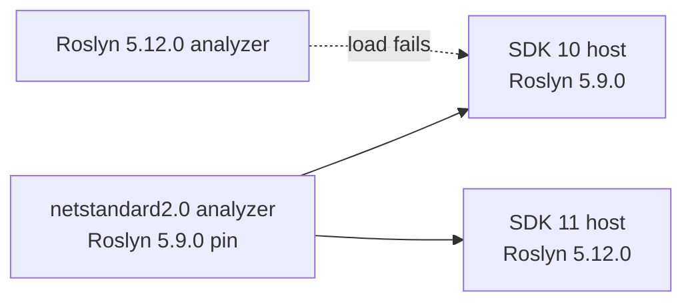

# .NET 11 Upgrade Practices
*Updated: 2026-11-10T23:33:05Z*

Rules this repository follows while it moves from `net10.0` to `net11.0`. Each
rule came from a probe on the GA SDK. See [project-structure.md](project-structure.md)
for the solution shape and [analyzers/package-layout.md](analyzers/package-layout.md)
for the published package layout.

## Two Bands, One Root

The GA SDK installs side by side with the `net10.0` SDK in one root. A bare
`dotnet` then lists both bands.

| Band | Use |
|------|-----|
| SDK `11.0.1xx` | Primary target, `net11.0` builds, package publish |
| SDK `10.0.4xx` | The `net10.0` analyzer proof only |

Run a proof by naming the root when `PATH` may resolve the other binary. Record
the band beside the result. A proof without a named band is not evidence.

A non-interactive shell can resolve an older root first. A script that then
reads a `global.json` pinned to the new band fails SDK resolution with a
"SDK not found" message. Put the root that carries the pinned band first, or
call that binary by absolute path.

## One Framework For This Repository

Every project targets `net11.0`, and the repository builds and tests on that one
band. The analyzer test project is not multi-targeted.

Two rules follow:

1. Do not pass a TFM override on the command line to reach the other band. A
   global `TargetFramework` or `TargetFrameworks` property leaks into project
   references and breaks the `netstandard2.0` restore of the analyzer projects.
2. Prove the `net10.0` package reach with a consumer fixture instead, not with a
   second leg of the suite. See `tests/Net10Consumer`.

## Analyzer Reach

The published package must load in a `net10.0` host and a `net11.0` host from
one assembly. Three rules hold that reach:

1. Both analyzer assemblies stay `netstandard2.0`.
2. The shipped `Microsoft.CodeAnalysis.CSharp` pin stays in the host band that
   the `net10.0` SDK compiler provides. Roslyn loads an analyzer built on an
   older band forward, never backward.
3. Both analyzer projects pin `LangVersion` to `14.0`. The SDK 10 compiler must
   build the sources, and `latest` there is C# 14. A C# 15 form in analyzer
   source fails `CS8652` before the package is ever loaded.
4. A test-only Roslyn package may move to the SDK 11 band, because it never
   ships.



Prove the reach with a consumer, not with a pack. A pack-only check proves the
assembly builds, not that a host loads it.

`tests/Net10Consumer` is that consumer. It carries its own `global.json` pinned
to SDK 10, its own `Directory.Build.props` and `.targets` so no repository
analyzer reaches it, and a `nuget.config` that serves `E128.*` from
`artifacts/nupkgs`. Its source holds one deliberate `E128024` violation, so the
CI job can assert that the packaged analyzer loaded and reported. A run that
produces no diagnostic, or a load warning, fails the job.

## Union Results

`union` is GA syntax. It compiles at the default language version and needs no
preview flag.

```csharp
public union GreetingResult(Greeting, GreetingError);
```

A case type converts to the union implicitly, and a switch expression matches
the case types.

`where T : union` does not compile (`CS0246`). Constrain the helper on
`IUnion` instead. The compiler then rejects a non-union type argument with
`CS0315.`

```csharp
public static TOut Match<TUnion, TOut>(this TUnion value, Func<TUnion, TOut> match)
    where TUnion : IUnion;
```

`IUnion` exposes one member, `Value`. A hand-written type can satisfy it, so a
helper that reads the case list must prove the list stays closed.

## Closed Hierarchies

A `closed` type makes a switch exhaustive. A missing case reports `CS8509`,
which `TreatWarningsAsErrors` turns into a build failure. Do not mark a closed
type `abstract`, because the compiler rejects it with `CS9384`.

## Runtime Async

Runtime async stays opt-in. A `net11.0` project no longer needs
`EnablePreviewFeatures` for it.

```xml
<PropertyGroup Condition="'$(TargetFramework)' == 'net11.0' and '$(IsRoslynComponent)' != 'true' and '$(IsTestProject)' != 'true' and '$(IsBenchmarkProject)' != 'true'">
  <Features>$(Features);runtime-async=on</Features>
</PropertyGroup>
```

The group belongs in `Directory.Build.targets`. A `.props` group evaluates
before the project body sets `IsTestProject`, `IsRoslynComponent`, or a similar
role marker, so a `.props` condition reads them as empty and matches too much.

Never apply the switch to a `netstandard2.0` analyzer or to a `net10.0` leg.
`<UseRuntimeAsync>false</UseRuntimeAsync>` opts one project out. The absence of
`[AsyncStateMachine]` on a method detects the switch.

## Formatting Hazard

`scripts/format.sh` runs `jb cleanupcode` over the whole solution. On a new SDK
band that tool rewrites far more than the reported findings. Pass `--no-jb`
with an explicit file list, then fix only what the check reports.

One rewrite is unsafe. The formatter turns `new SyntaxList<StatementSyntax>(body)`
into `[with(body)]`, which fails with `CS9359`. Use `SyntaxFactory.SingletonList`
for that shape.

## Verification

Run these in order, and name the SDK band for each:

1. `scripts/runtime-matrix.sh --json` reports the pin and the framework set.
2. `scripts/build.sh --warnings` reports zero warnings and zero errors.
3. `scripts/format.sh --check` reports no finding.
4. `scripts/test.sh --all` reports the suite count.
5. `scripts/test.sh --all --framework net10.0` proves the `net10.0` leg of the
   test project. It does not prove the analyzer reach, because the active SDK
   compiles both legs. The reach proof is the `net10-consumer` CI job, which
   builds the same project under SDK 10.

## See Also

- [project-structure.md](project-structure.md): solution layout, CPM, props
- [analyzers/package-layout.md](analyzers/package-layout.md): shipped package layout
- [../dotnet-reference/dep-map.md](../dotnet-reference/dep-map.md): pinned versions and images
