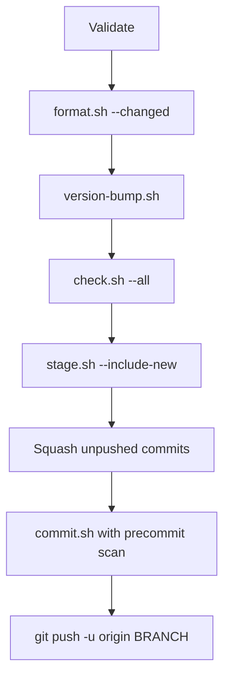

# Shipping
*Updated: 2026-11-12T00:54:46Z*

`scripts/verify-and-ship.sh` ships the current feature branch as one squashed commit. It formats, bumps the version, runs the canonical check, squashes, scans, commits, and pushes. The script runs only when an operator asks for it, because it commits and pushes.

## Contract

```bash
scripts/verify-and-ship.sh --message MSG [--no-version-bump] [--json]
```

| Option              | Effect                                                    |
| ------------------- | --------------------------------------------------------- |
| `--message`, `-m`   | Sets the commit message. The option is required.          |
| `--no-version-bump` | Skips `scripts/internal/version-bump.sh`.                 |
| `--json`            | Prints one JSON object and hides the output of each step. |

The message must hold no email address. The script rejects every address, including a reserved placeholder such as `user@example.com`.

The script has no squash option. Every run squashes the unpushed commits. An unknown flag, including the removed `--squash`, exits with an error before any step runs.

## Pipeline



The diagram shows seven steps after validation. Each step runs only when the step before it succeeds.

1. Format the changed files.
2. Bump the version. The bump comes before the check, so the check verifies the final file contents.
3. Run `scripts/check.sh --all`. The check includes the format check. The script never passes `--no-format`.
4. Stage every change, including new files.
5. Squash the unpushed commits with a soft reset.
6. Run `scripts/internal/commit.sh`. It runs the precommit scan over the whole squashed index, then commits. The scan therefore sees the contents of every earlier unpushed commit.
7. Push the branch.

## Version Inference

`scripts/internal/version-bump.sh` picks the bump level from the commit subjects that exist before the squash, the release-note rows, and the `.cs` changes since the merge base. The ship script passes the final message with `--message`. The bump script treats it as one more commit, so a `feat:` or breaking marker in the final message raises the bump level. Use `--no-version-bump` to skip the bump.

## Validation

Validation runs before any step changes the repository. A failed validation exits nonzero and leaves the files, the history, and the remote as they were.

| Condition                                                   | Result              |
| ----------------------------------------------------------- | ------------------- |
| No message, or any email address in the message             | Exit with an error. |
| Detached HEAD                                               | Exit with an error. |
| Branch is the default branch or `main`                      | Exit with an error. |
| `origin/<default>` does not exist                           | Exit with an error. |
| Upstream remote is not `origin`                             | Exit with an error. |
| Upstream branch is not `refs/heads/<branch>`                | Exit with an error. |
| Upstream is configured but does not resolve                 | Exit with an error. |
| Upstream tip is not an ancestor of `HEAD` (diverged branch) | Exit with an error. |
| `origin/<branch>` exists but the branch has no upstream     | Exit with an error. |
| Branch shares no history with `origin/<default>`            | Exit with an error. |
| `HEAD` equals the squash base and the working tree is clean | Exit with an error. |

The upstream rule rejects a branch that tracks `origin/main`, a branch that tracks another remote, and a branch that tracks a local branch. The rule applies even when `origin/<branch>` exists.

The default branch is the target of `refs/remotes/origin/HEAD`. The script falls back to `main` when that ref is missing.

## Squash Rule

The script folds only commits that no remote has seen. It never rewrites a pushed commit and never force-pushes.

- **Upstream exists:** the squash base is the upstream tip. The script runs `git reset --soft` to that commit. The new commit sits on top of the pushed history, so the push is a fast-forward.
- **No upstream:** the squash base is the merge base with `origin/<default>`. The branch has never been pushed, so the rewrite is local.

The soft reset keeps the index and the working tree.

## Failure Behavior

- A failing format, bump, check, or stage step stops the run. The step output goes to standard error. No later step runs and nothing is pushed.
- A failing precommit scan or commit restores `HEAD` to its value before the squash with `git reset --soft`. The staged changes stay staged. Nothing is pushed.
- A failing push keeps the squashed commit on the branch. The script prints the original `HEAD` and the command `git reset --soft <original HEAD>`, which restores the original commits. The remote result can be unknown after a failed push, so run `git fetch origin` and compare `origin/<branch>` before you retry.

## Tests

`scripts/verify-and-ship-test.sh` runs the script in temporary git repositories under `.claude/tmp/`. Each repository has a local bare remote. Fake `format`, `check`, `version-bump`, and `precommit` scripts log each call. The real `lib.sh`, `stage.sh`, and `commit.sh` run unchanged. Two cases swap in the real `precommit.sh`. Four cases swap in the real `version-bump.sh` to check that the final message sets the bump level.

The suite takes about a minute. `scripts/ci.sh` and the CI `lint` job always run it. `scripts/check.sh --all` runs it when a script that it covers differs from the merge base with main.

```bash
scripts/verify-and-ship-test.sh
```

The output ends with `tests=N passed=N failed=N assertions=N`. The exit code is nonzero when any case fails. The tests never touch this repository, its history, or the network.

The cases cover these behaviors:

- Rejection of the default branch, a detached HEAD, and a missing base.
- Rejection of a diverged, unresolvable, or missing upstream.
- Rejection of an upstream on the default branch, on another remote, or on a local branch.
- Rejection of a missing message, an email in the message, and a placeholder email in the message.
- Rejection of the removed `--squash` flag and of a branch with nothing to ship.
- Short-circuit on a format, bump, check, or precommit failure.
- History restore after a failed commit.
- The real precommit scan blocks an email address or a home path that sits in an earlier unpushed commit. The test builds each value at run time, so the test file holds neither.
- A rejected push keeps the commit and prints the original `HEAD` with the restore command.
- One squashed commit over an existing upstream, with the old pushed tip kept as the parent and the scan seeing every unpushed file.
- One squashed commit on a first push.
- The gate order: format, bump, check, precommit. The check runs after the bump and keeps the format step.
- The `--no-version-bump` and `--json` options.
