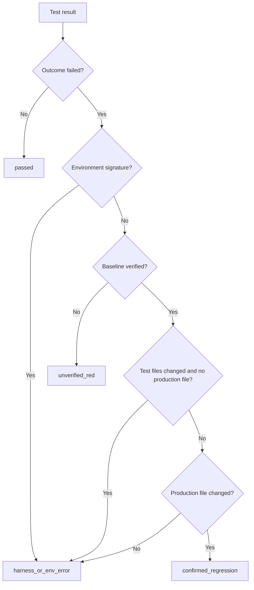
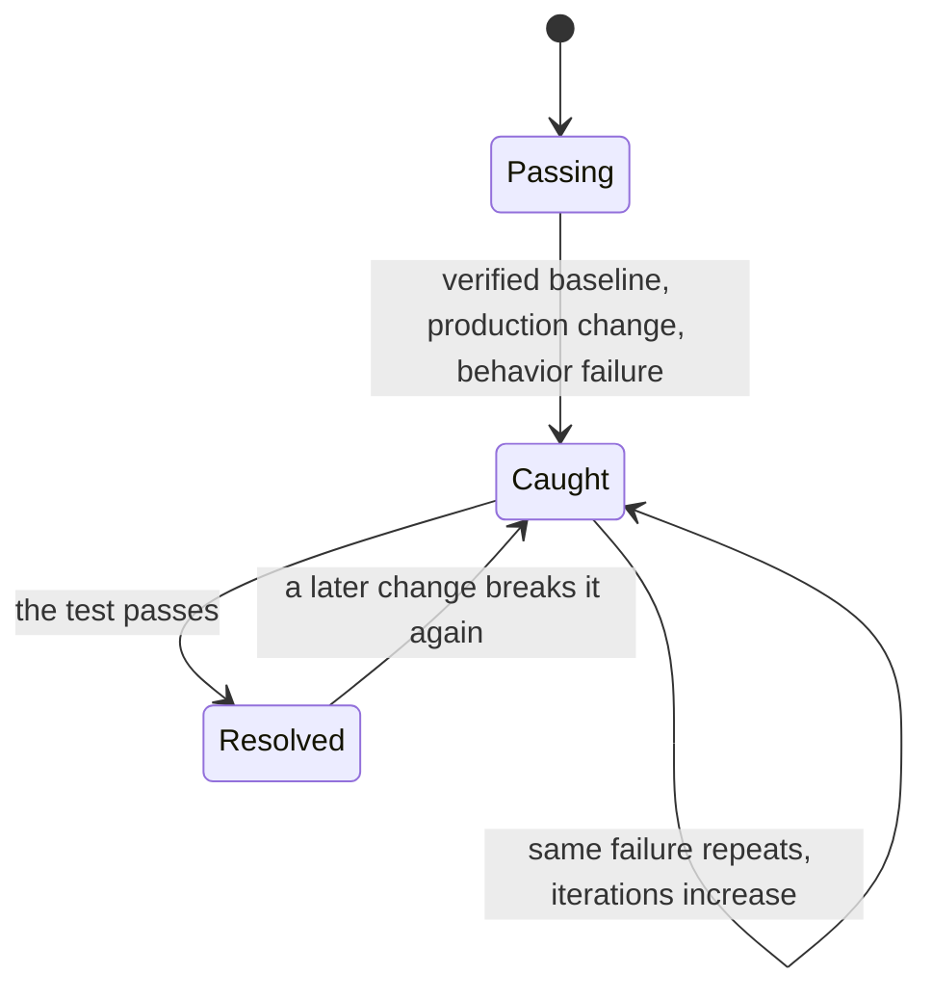

# TDD Regression Tracking
*Updated: 2026-11-19T20:45:21Z*

`scripts/tdd-track.sh` separates real regressions from Red-phase failures in
the Red/Green TDD loop with coding LLMs. It records the provenance of every
test, classifies each failure, and keeps an append-only regression ledger.

The test runner is Microsoft Testing Platform (MTP) with xUnit v3. MTP writes
TRX through `Microsoft.Testing.Extensions.TrxReport`. Every test project
references that package. `scripts/test.sh --trx-dir DIR` collects the reports
for one run. See [Testing](../dotnet/testing.md) for the runner contract.

## Data Files

| Path                              | Tracked | Content                                         |
| --------------------------------- | ------- | ----------------------------------------------- |
| `.tdd/test-registry.json`         | Yes     | Test file and test case provenance and baseline |
| `.tdd/regression-catches.jsonl`   | Yes     | Append-only `caught` and `resolved` events      |
| `.tdd/state.json`                 | No      | Open events, iteration counts, last run         |
| `.tdd/tmp/`                       | No      | Parsed results, TRX input, last test output     |

The registry and the ledger are the shared record. The runtime state rebuilds
from the ledger, so a lost state file does not lose an open event.

## Registry Schema

The key of a test entry is `test_file::test_name`. The display name includes
theory parameters, so each case has its own baseline.

```json
{
  "schema_version": 1,
  "files": {
    "tests/Example.Tests/PriceTests.cs": {
      "origin": "llm-generated",
      "verified_baseline": false,
      "registered_at": "2026-11-19T20:37:01Z",
      "registered_commit": "<sha>"
    }
  },
  "tests": {
    "tests/Example.Tests/PriceTests.cs::Example.Tests.PriceTests.Rounds_Up": {
      "test_file": "tests/Example.Tests/PriceTests.cs",
      "test_name": "Example.Tests.PriceTests.Rounds_Up",
      "method_name": "Rounds_Up",
      "class_name": "Example.Tests.PriceTests",
      "origin": "llm-generated",
      "verified_baseline": true,
      "first_green_commit": "<sha>",
      "first_green_at": "2026-11-19T20:37:01Z"
    }
  }
}
```

`origin` is `llm-generated` or `human-written`. A test entry inherits the file
origin when it has none. `verified_baseline` becomes true on the first passing
run, and `first_green_commit` records that commit. `register --approve` marks a
file or case as a baseline without a passing run. Git hooks are not installed
in this repository, so `analyze` is the post-test command.

## Classification Order

The classifier reads the TRX result, the registry, and the changed files.
The order is fixed, and the first match wins.



- `assertion`: XUnit assertion text such as `Assert.Equal() Failure` or
  `Xunit.Sdk.*Exception`. Assertion detection runs first.
- `environment`: timeout, cancellation, network, missing assembly, mock,
  fixture, or compilation text. The pattern list lives in `CLASSIFY_JQ`.
- `behavior`: every other exception. A production exception counts as a
  behavior failure.

`harness_or_env_error` covers test-only edits and a verified failure with no
production change. A test-only edit means changed test files and no changed
production file. A flaky verified test without a production change also lands
here. An unverified failure stays `unverified_red` when its test file is new.
That case is the normal Red phase.

Changed files come from `HEAD~1..HEAD`, the staged tree, the working tree, and
untracked files. A production file is a path under `src/` or `benchmarks/`.
A test file is a path under `tests/` or a file whose name ends in `Tests.cs`.

## Event Lifecycle



A `caught` event is appended only when no open event exists for the test. A
repeat failure increments `iterations` in the state and appends nothing. The
open set is rebuilt from the ledger on every run, so re-running the same suite
cannot spam the ledger. A pass closes the open event and appends `resolved`
with `iterations_to_green` and `fix_commit`. `iterations_to_green` counts the
failing analysis runs that observed the event before the passing run.

Each ledger line has this shape:

```json
{"event_id":"<uuid>","timestamp":"2026-11-19T20:37:01Z","event_type":"caught",
 "base_commit":"<sha>","current_commit":"<sha>",
 "test_file":"tests/Example.Tests/PriceTests.cs",
 "test_name":"Example.Tests.PriceTests.Rounds_Up","test_origin":"llm-generated",
 "changed_prod_files":["src/Example/Price.cs"],
 "failure_summary":{"kind":"assertion","message":"Assert.Equal() Failure: Values differ"},
 "resolution_details":null}
```

A `resolved` event carries `resolution_details` with `caught_event_id`,
`fix_commit`, `iterations_to_green`, and the production files changed at
resolution.

## Commands

Register a new LLM test file before the Red run:

```bash
scripts/tdd-track.sh register --changed --origin llm-generated
```

Register one test case, or approve a baseline:

```bash
scripts/tdd-track.sh register --test "tests/Example.Tests/PriceTests.cs::Example.Tests.PriceTests.Rounds_Up"
scripts/tdd-track.sh register --file tests/Example.Tests/PriceTests.cs --approve
```

Run tests and attribute every failure:

```bash
scripts/tdd-track.sh analyze -- GreeterTests
scripts/tdd-track.sh analyze -- --trait Category=CI
```

Run one full analysis after the feature lands. It adopts every observed test and
records the first baseline:

```bash
scripts/tdd-track.sh analyze -- --all
```

Analyze an existing report without a test run:

```bash
scripts/tdd-track.sh analyze --no-run --trx .tdd/tmp/trx-2026-11-19T20-37-01Z --json
```

Print prompt-ready history for the files in the working tree:

```bash
scripts/tdd-track.sh report --markdown
scripts/tdd-track.sh report --markdown --files "src/Example/Price.cs"
```

`analyze` exits 1 when a test fails and 2 when no TRX exists. `--dry-run`
prints the classification and writes no tracked file.

## LLM Workflow

1. Write the failing test.
2. Tag the new test: `scripts/tdd-track.sh register --changed --origin llm-generated`.
3. Run `scripts/tdd-track.sh analyze -- <ClassName>`.
4. Confirm the failure is `unverified_red`, not a harness error.
5. Implement the production code and run `analyze` again.
6. Treat a new `unverified_red` that fails identically twice as a suspect test.
7. After a production change, treat a `confirmed_regression` on a verified test
   as a real break and fix the production code, not the assertion.
8. Add the `report --markdown` block to the next prompt when it is not empty.

## Monitoring

Five surfaces read the same files.

- `scripts/tdd-track.sh report` prints totals, the origin split, hotspot files,
  and the mean iterations to green.
- `scripts/tdd-track.sh report --markdown` prints the past regressions that
  touch the working tree. Add it to a prompt.
- `scripts/tdd-track.sh analyze ... --markdown` prints the current-run counts
  and the confirmed regressions.
- `.claude/statusline.sh` shows the open event count from `.tdd/state.json`.
- The CI `Report: TDD regressions` step writes the current-run summary and the
  historical markdown to the GitHub job summary. It adds a warning annotation
  for each confirmed regression. The step runs after a failed test job.

CI analyzes with `--dry-run`, so a runner never rewrites the tracked files. The
registry must be populated and committed from a local run. Do this once:

```bash
scripts/tdd-track.sh analyze -- --all
git add .tdd/test-registry.json
```

The CI checkout uses `fetch-depth: 2`. `HEAD~1` gives the PR base for a merge
ref and the previous commit on `main`. `dotnet test` writes the TRX files and
the analysis JSON under `test-results/`, which the existing coverage artifact
uploads.

## Invariants

- `dotnet test` owns `--results-directory`. A test app accepts one value.
  `scripts/test.sh` passes `--report-trx` after `--` and the directory before it.
- The merged TRX under `merged/` is skipped. Reading it would count every test
  twice.
- The registry update writes an atomic temporary file and renames it.
- The ledger is append-only. Never rewrite a line.
- The classifier resolves a test file from the TRX class name through the
  `tests/` file index. A class name that does not match a file falls back to a
  method search.
- `--origin` applies to newly observed tests and files. It never retags an
  existing entry. Use `register` to retag.

## Test Suite

`scripts/tdd-track-test.sh` runs the classifier, parser, registry, dedupe,
resolution, and report behavior in throwaway git repositories with synthetic
TRX. It runs in the CI `lint` job. Run it directly after a script change.

## Related

- [Testing](../dotnet/testing.md): MTP, xUnit v3, categories, and test scripts.
- [Shell Authoring](shell-authoring.md): script prerequisites and the lint gate.
- [Deterministic Scripts](../../.claude/rules/deterministic-scripts.md): routing.
