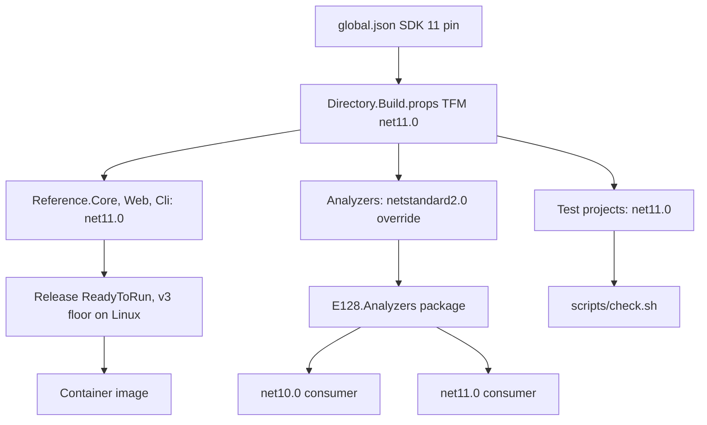

# .NET 11 Upgrade Plan
*Created: 2026-11-07T04:25:42Z*

*Updated: 2026-11-10T20:42:20Z*

## Metadata

| Field      | Value                                            |
|------------|--------------------------------------------------|
| Criticality| C3: high                                         |
| Status     | draft                                            |
| Created    | 2026-11-07T04:25:42Z                             |
| Branch     | `feature/net11-upgrade`                          |
| Source     | `~/repos/e128/pugworks/plans/net11-upgrade`, adapted |

## Overview

Move the reference application from `net10.0` to `net11.0` when .NET 11
reaches GA, then turn on runtime async as a separate step for the application
projects only.

The bump itself is one property edit. The risk sits in five places:

1. A published analyzer package that loses `net10.0` reach through a Roslyn
   package bump.
2. A raised CPU baseline on Release ReadyToRun output and on the container.
3. Library behavior changes that alter results without a compile error.
4. A language-version cliff that activates dormant analyzer rules, with
   `dotnet_analyzer_diagnostic.severity = error` in force.
5. A runtime async switch that rewrites stack traces and allocation profiles
   while leaving behavior alone.

The plan splits the work so each phase ends green. Phases 1 and 2 leave the
committed TFM alone. Phase 3 lands the TFM with runtime async off, so a
regression belongs to one change. Phase 4 turns runtime async on one project
at a time, and never on a Roslyn component.

The whole plan runs on the GA SDK. An RC build never reaches the pin.

## Second Objective: Union Results and Guidance Rules

The TFM move is the first objective. The plan carries a second one that the
source plan does not have. Recent work on union types and railway-oriented
flow in C# 15 shows a shape worth teaching. The repository should adopt it,
then ship an analyzer that points a developer or an agent at it.

The end state has three parts:

1. The reference application expresses expected failure as a union result
   type, and composes it through a small set of generic helpers.
2. A generic helper states its requirement in the type system, so the one
   correct call is also the easiest call. A caller cannot reach the wrong
   shape through the helper.
3. An `E128.Analyzers` rule family names the older shapes and leads to the
   newer .NET 11 feature. That family is the part that scales, because an
   agent reads a diagnostic and a code fix, not a design document.

The design goal is one shape that holds under pressure. Each helper takes the
narrowest signature that admits every result union and no other type. A helper
constrained that way removes a special case at each call site. The compiler
then rejects the wrong call, and the analyzer explains the rejection.

The union shape depends on what the GA compiler accepts. `union` and `closed`
ship as preview scaffolding (CL-31). A union type used as a generic constraint
is the open question (CL-32). Phase 0 answers it, and the answer selects one of
three designs in § Union Constraint Gate. The plan never assumes the answer.

This objective lands as two phases, after the TFM proves green:

- Phase 6 rewrites the application result types and adds the generic helpers.
- Phase 7 builds the guidance rule family over what Phase 6 proved.

The analyzer work carries one reach risk of its own. A rule that reads `union`
syntax must not raise the host floor of the published package. § Union Rule
Reach Gate states the constraint and the exits.

## What Changes From The Source Plan

The pugworks plan targets one application solution. This repository publishes
`E128.Analyzers` to nuget.org, so the plan adds a constraint the source plan
does not carry: the package keeps `net10.0` reach.

| Source item | Change here | Reason |
|-------------|-------------|--------|
| Analyzer TFM moves with the solution | Analyzer assemblies stay `netstandard2.0` | The TFM move would drop `net10.0` consumers |
| Roslyn package bump with the SDK band | Roslyn pin stays in the `net10.0` host band | A newer band raises the minimum host compiler |
| `pug-package-compat.nu` restore probe | `scripts/build.sh` and `scripts/dep-check.sh` | The package set is small, and one revert undoes a failed restore |
| AOT publish verification | Removed | No project sets `PublishAot` (CL-5) |
| Benchmark allocation comparison | Removed | The repository holds no benchmark project (CL-20) |
| Runtime async end state is one unconditional property | End state is a conditional property group | An unconditional switch breaks the analyzer reach and the `net10.0` leg |
| `specs/`, `pug-claims-gate`, `metrics-stamp` | `scripts/internal/plan-gate.sh` and `scripts/internal/plan-close.sh` | The source gate engine does not exist here (CL-20) |
| Apple ReadyToRun target discussion | Kept, and the Debian container is added | The container is the published artifact that gains the floor |
| Union adoption in the application | Kept, and expanded into the rewrite plus a rule family | The source plan treats unions as a later library decision. This repository treats them as the end state |

## Claims Register

| #     | Claim | Evidence | Verification | Result | Lifetime |
|-------|-------|----------|--------------|--------|----------|
| CL-1  | The default TFM is `net10.0`, set once in `Directory.Build.props` | `Directory.Build.props` target framework group | `rg -n "<TargetFramework>net10.0</TargetFramework>" Directory.Build.props` | confirmed | short-lived |
| CL-2  | `LangVersion` is `latest`, so the SDK bump raises the language band | `Directory.Build.props` language group | `rg -n "<LangVersion>latest</LangVersion>" Directory.Build.props` | confirmed | durable |
| CL-3  | Release builds set `ReadyToRun=true` and `EnablePreviewFeatures=false` | `Directory.Build.props` Release group | `rg -n -e "<ReadyToRun>true</ReadyToRun>" -e "EnablePreviewFeatures" Directory.Build.props` | confirmed | durable |
| CL-4  | Both analyzer assemblies target `netstandard2.0` and no other project sets a TFM | `src/E128.Analyzers/E128.Analyzers.csproj`, `src/E128.Analyzers.CodeFixers/E128.Analyzers.CodeFixers.csproj` | `rg -n "TargetFramework" --glob '*.csproj' .` returns two paths | confirmed | durable |
| CL-5  | No project sets `PublishAot`, so the plan carries no AOT verification. `Directory.Build.props` holds an AOT group that no project triggers | `Directory.Build.props` `PublishAot` condition | `rg -l "<PublishAot>true</PublishAot>" --glob '*.csproj' .` returns nothing | confirmed | durable |
| CL-6  | `global.json` pins SDK `10.0.403`, sets `rollForward: latestPatch` and `allowPrerelease: false` | `global.json` | `rg -n -e version -e rollForward -e allowPrerelease global.json` | confirmed | short-lived |
| CL-7  | `global.json` also selects the MTP runner | `global.json` `test.runner` | `rg -n "Microsoft.Testing.Platform" global.json` | confirmed | durable |
| CL-8  | `AnalysisLevel` is `latest-all`, with Security, Reliability, and Performance at `All` | `Directory.Build.props` code analysis group | `rg -n -e AnalysisLevel -e "AnalysisMode" Directory.Build.props` | confirmed | durable |
| CL-9  | `.globalconfig` sets every analyzer diagnostic to `error` | `.globalconfig` blanket default | `rg -n "dotnet_analyzer_diagnostic.severity" .globalconfig` | confirmed | durable |
| CL-10 | `tests/.globalconfig` overrides the root at `global_level = 101` | `tests/.globalconfig` | `rg -n "global_level" .globalconfig tests/.globalconfig` | confirmed | durable |
| CL-11 | The analyzer test project inherits `net10.0` and sets no `TargetFrameworks` | `tests/E128.Analyzers.Tests/E128.Analyzers.Tests.csproj` | `rg -n "TargetFramework" tests/E128.Analyzers.Tests/E128.Analyzers.Tests.csproj` returns nothing | confirmed | short-lived |
| CL-12 | Analyzer test snippets resolve against `ReferenceAssemblies.Net.Net100`, with two `NetStandard` rows | `tests/E128.Analyzers.Tests` | `rg -c "ReferenceAssemblies.Net.Net100" tests/E128.Analyzers.Tests` | confirmed | short-lived |
| CL-13 | `StaleReferenceAssembliesAnalyzer` defaults its minimum framework version to 100, and the tests sit at 100 | `src/E128.Analyzers/Testing/StaleReferenceAssembliesAnalyzer.cs` | `rg -n "MinimumVersionOptionKey" src/E128.Analyzers/Testing/StaleReferenceAssembliesAnalyzer.cs` | confirmed | durable |
| CL-14 | The Roslyn packages are pinned at `5.9.0` in one place | `Directory.Packages.props` Roslyn group | `rg -n "Microsoft.CodeAnalysis" Directory.Packages.props` | confirmed | short-lived |
| CL-15 | No source references `AsyncStateMachine`, `runtime-async`, or `UseRuntimeAsync` | none | `rg -n -e AsyncStateMachine -e runtime-async -e UseRuntimeAsync .` returns nothing | confirmed | durable |
| CL-16 | Debug sets `EnablePreviewFeatures` to true and Release sets it to false | `Directory.Build.props` Debug and Release groups | `rg -n -A1 "EnablePreviewFeatures" Directory.Build.props` | confirmed | durable |
| CL-17 | The Dockerfile pins `sdk:10.0-resolute` and `aspnet:10.0-resolute` | `Dockerfile` | `rg -n "mcr.microsoft.com/dotnet" Dockerfile` | confirmed | short-lived |
| CL-18 | `README.md` carries the `.NET 10` badge and one summary sentence | `README.md` | `rg -n "\.NET 10" README.md` returns two lines | confirmed | short-lived |
| CL-19 | `AGENTS.md` states the supported targets | `AGENTS.md`, .NET Development section | `rg -n "Target \.NET 10" AGENTS.md` | confirmed | short-lived |
| CL-20 | The source plan's gate engine is absent here: no `specs/`, no `benchmarks/`, no claims gate, no metrics stamp | none | `ls -d specs benchmarks` fails, `rg -l "claims-gate|metrics-stamp" scripts` returns nothing | confirmed | durable |
| CL-21 | `Directory.Build.targets` adds the analyzer as an `Analyzer` reference to every project where `IsRoslynComponent` is not true | `Directory.Build.targets` analyzer item group | `rg -n "OutputItemType=\"Analyzer\"" Directory.Build.targets` | confirmed | durable |
| CL-22 | CI installs `dotnet-version: 10.0.x` and calls raw `dotnet`, and `publish.yml` packs on the same band | `.github/workflows/ci.yml`, `.github/workflows/publish.yml` | `rg -n "dotnet-version" .github/workflows` | confirmed | short-lived |
| CL-23 | `scripts/test.sh` runs `dotnet test --solution` with a `Category=CI` trait default, so a multi-target project runs every leg | `scripts/test.sh` | `rg -n -e "dotnet test" -e "TRAIT" scripts/test.sh` | confirmed | durable |
| CL-24 | `Microsoft.Extensions.*`, `Mvc.Testing`, and `Diagnostics.Testing` are pinned in the `10.0.14` and `10.11.0` bands, and no `net10.0` leg consumes them | `Directory.Packages.props` testing group | `rg -n -e "Mvc.Testing" -e "Diagnostics.Testing" Directory.Packages.props` | confirmed | short-lived |
| CL-25 | The analyzer test project references no `Microsoft.Extensions` package, so the extensions bump leaves the `net10.0` leg alone | `tests/E128.Analyzers.Tests/E128.Analyzers.Tests.csproj` | `rg -n "Microsoft.Extensions" tests/E128.Analyzers.Tests/E128.Analyzers.Tests.csproj` returns nothing | confirmed | durable |
| CL-26 | `PolySharp` supplies the nullable analysis attributes for the `netstandard2.0` assembles | both analyzer project files | `rg -n "PolySharpIncludeGeneratedTypes" src --glob '*.csproj'` | confirmed | durable |
| CL-27 | The analyzer package ships a `lib/netstandard2.0` placeholder and two `analyzers/dotnet/cs` entries | `src/E128.Analyzers/E128.Analyzers.csproj` packaging group | `rg -n "PackagePath" src/E128.Analyzers/E128.Analyzers.csproj` | confirmed | durable |
| CL-28 | `scripts/podman.sh` exists for the container check | `scripts/podman.sh` | `scripts/help.sh \| rg podman` | confirmed | durable |
| CL-29 | The solution holds ten projects, five under `src/` and five under `tests/` | `E128.Reference.slnx` | `scripts/solution-inventory.sh --json` reports ten | confirmed | durable |
| CL-30 | `scripts/assert.sh` offers `--build-pass`, `--test-pass`, and `--clean-working-tree` | `scripts/assert.sh` | `rg -n -e "--build-pass" -e "--test-pass" scripts/assert.sh` | confirmed | durable |
| CL-31 | `union` and `closed` ship as preview scaffolding. `union` needs `UnionAttribute` and `IUnion`, and `closed` needs `ClosedAttribute` | C# 15 documentation | Probe in Phase 0, then record whether `EnablePreviewFeatures` is required | unverified | short-lived |
| CL-32 | A union type in a generic constraint (`where T : union`) is documented for C# 15 | none | Probe in Phase 0. Two fallbacks are listed in § Union Constraint Gate | unverified | short-lived |
| CL-33 | The repository holds no result, railway, or discriminated-union type. `Reference.Core` carries a greeter, two models, a repository, and a service | `src/E128.Reference.Core` | `rg -n -e "class .*Result" -e "record .*Result" -e OneOf -e Either src` returns only analyzer type names | confirmed | short-lived |
| CL-34 | Both analyzer assemblies compile against `Microsoft.CodeAnalysis.CSharp` at the pinned `net10.0` band, which cannot parse C# 15 union syntax | `Directory.Packages.props` Roslyn group | Probe in Phase 0. Record whether an interface-only union declaration parses at that band | unverified | short-lived |
| CL-35 | The last assigned diagnostic ID is `E128218`, and new rules continue from it | `src/E128.Analyzers/AnalyzerReleases.Shipped.md` | `scripts/analyzer-stats.sh --json` reports the highest assigned ID | confirmed | short-lived |

## Requirements

1. The reference application builds and every test passes on `net11.0` with no
   new warnings, with runtime async still off.
2. The analyzer assemblies keep `netstandard2.0`, and the published package
   still resolves for a `net10.0` consumer.
3. The Roslyn package pin stays in the band that the `net10.0` SDK compiler
   provides, so a routine dependency bump cannot raise the host floor.
4. The analyzer suite passes on a `net10.0` leg under the `net10.0` SDK, with no
   analyzer load warning and a nonzero test count.
5. Runtime async is enabled for the application projects at the end of the
   plan, through one conditional property group, and never for a Roslyn
   component.
6. The runtime async rollout starts on one leaf project and reaches the next
   project only after the previous one is green.
7. Stack traces and allocation profiles are re-checked after the switch.
8. Shipped artifacts carry a documented CPU floor, and the floor matches the
   ReadyToRun target .NET 11 produces on Linux.
9. Every breaking-change item that applies to this repository is verified or
   fixed.
10. The upgrade path stays reversible: one property edit back to `net10.0`
    restores the previous build.
11. The lode records the post-upgrade state, so no lode file describes
    `net10.0` as current.
12. `README.md` and `AGENTS.md` state the new primary target.
13. The upgrade starts from a GA SDK. An RC pin never reaches `main`.
14. The diagnostic delta from the .NET 11 rule set is recorded against the
    Phase 0 warning set before any sweep starts.
15. Runtime async stays off until Phase 4 proves it, so no regression in
    Phases 1 to 3 has two candidate causes.
16. The analyzer test project proves both bands from one project, and the
    `net10.0` leg runs under the `net10.0` SDK in CI.
17. The reference application expresses expected failure as a union result
    type, and one generic helper composes it for every result union.
18. A union rule in the published package adds no minimum host compiler. The
    `net10.0` reach holds after the rule lands.
19. The guidance rule family names an older shape and its replacement, and each
    rule ships a code fix only when the fix is mechanical.

## Analyzer Reach Gate

The TFM move cannot start until the analyzer reach holds. The gate has four
checks, and each one fails a later phase rather than this one:

| Check | Pass condition | Failure mode |
|-------|----------------|--------------|
| Assembly TFM | Both analyzer projects still read `netstandard2.0` | A `net11.0` assembly cannot load in a `net10.0` host |
| Roslyn pin | `Microsoft.CodeAnalysis.*` stays in the `net10.0` host band | The compiler refuses to load the analyzer, or a load warning appears |
| Compiler leg | The analyzer suite passes on the `net10.0` leg under SDK 10 | A silent no-op or a zero-test run |
| Package layout | The `analyzers/dotnet/cs` entries and the `lib/netstandard2.0` placeholder are unchanged | NuGet lists no framework and a consumer cannot resolve the package |

A failing check has three exits, and the plan takes the first that works:

1. Keep the package version that the `net10.0` host band already provides.
2. Drop the package or the API when nothing needs it.
3. Stop. Record the blocker in context.md, and leave `TargetFramework` alone.

## Union Constraint Gate

The constraint question decides the helper shape. Phase 0 probes it, and the
plan takes the first design that compiles.

| Design | Helper signature | Applies when | Cost |
|--------|------------------|--------------|------|
| 1. Union constraint | `static TOut Match<TUnion, TOut>(this TUnion value, ...) where TUnion : union` | The compiler accepts `union` in a `where` clause (CL-32) | None. The constraint states intent, and the compiler rejects a non-union caller |
| 2. Union interface constraint | `static TOut Match<TUnion, TOut>(this TUnion value, ...) where TUnion : IUnion` | The interface is public and usable as a constraint, but the `union` keyword is not | One interface constraint. A hand-written type can still satisfy it |
| 3. Per-type overloads | One helper per result union, or one `IResult` interface owned by the repository | Neither of the above compiles | Duplication per union type. The analyzer still guides callers |

Design 1 is the target. Design 3 is the floor. The plan records the answer in
context.md § Architectural Decisions and does not rewrite a helper twice.

A generic helper on a union is only safe when the union is closed to the
declaration site. A hand-rolled type that implements `IUnion` would satisfy
Design 2 without listing its cases. The helper must therefore read the case
list from the attribute or the interface, never from a convention.

## Union Rule Reach Gate

A rule that names C# 15 syntax risks the published package reach. The analyzer
assemblies build against the Roslyn band of the `net10.0` SDK (CL-34), and that
band does not parse a `union` declaration. The gate holds these checks:

| Check | Pass condition | Failure mode |
|-------|----------------|--------------|
| Rule source | The rule uses no C# 15 Roslyn API, so the assembly still compiles at the pinned band | The package build fails, or the pin must move and the `net10.0` reach drops |
| Rule trigger | The rule reads the syntax tree by node name, or reads `UnionAttribute` and `IUnion` by metadata name | A rule that needs a typed union node raises the floor |
| Dormant on a `net10.0` host | The rule reports nothing on a `net10.0` compilation, because no union syntax parses there | A false positive in a consumer that cannot use the feature |
| Test leg | C# 15 snippet tests are excluded from the `net10.0` leg | The leg fails to parse its own test data |

A failing check has three exits, and the plan takes the first that works:

1. Rewrite the rule against syntax node names and metadata names.
2. Move the rule to a rule family that reports only on a `net11.0` compilation,
   gated on the language version the compilation reports.
3. Stop. Record the blocker in context.md, and keep the rule out of the package
   until the support-window decision in § Roadmap Handoff.

## Verifiable Behaviors

| # | Given | When | Then |
|---|-------|------|------|
| 1 | The solution on `net11.0` | `scripts/build.sh --warnings` runs | The build succeeds with zero errors and zero new warnings |
| 2 | The solution on `net11.0` | `scripts/test.sh --all` runs | The suite passes at or above the Phase 0 baseline count |
| 3 | The analyzer test project | `scripts/build.sh --project E128.Analyzers.Tests` runs | Both legs build, and the report names both frameworks |
| 4 | The analyzer suite | It runs on the `net10.0` leg under SDK 10 | The test count is nonzero and no analyzer load warning appears |
| 5 | Both analyzer projects | Their project files are read | `TargetFramework` is `netstandard2.0` |
| 6 | The package | `dotnet pack` runs | The archive carries two `analyzers/dotnet/cs` entries and the `lib/netstandard2.0/_._` placeholder |
| 7 | A Release build on Linux | The output is inspected | ReadyToRun compilation succeeds against the v3 target |
| 8 | The container image | `scripts/podman.sh` builds and starts it | `GET /health` returns a healthy status |
| 9 | A `net11.0` solution with runtime async off | `dotnet-counters` samples `System.Runtime` during a suite run | Allocation rate, gen0 count, and p99 latency are recorded in context.md |
| 10 | Runtime async is on for one project | Build output is inspected | The project's async methods carry no `[AsyncStateMachine]` attribute |
| 11 | Runtime async is on for one project | `scripts/test.sh --all` runs | The suite passes at or above the baseline count |
| 12 | Runtime async is on for every application project | The analyzer suite runs on the `net10.0` leg | The suite still passes, and no analyzer project carries the switch |
| 13 | A release build with the switch on | The property group is read | The switch is gated on `net11.0` and on `IsRoslynComponent` not true |
| 14 | The lode | It is read after Phase 5 | No lode file describes `net10.0` as the current target |
| 15 | A result union in `Reference.Core` | A caller composes it with the generic helper | The call site carries no cast, no exception, and no type test |
| 16 | The generic helper under Design 1 | A non-union type is passed as the type argument | The build fails, so the constraint rejects the wrong call |
| 17 | The reference application | `scripts/test.sh --all` runs | The suite passes at or above the baseline count, and the result-path tests cover each case |
| 18 | The guidance rule family | The analyzer suite runs | Each rule reports on its named older shape and stays silent on the union shape |
| 19 | The published package | A `net10.0` project consumes it | The union rules load, report nothing, and raise no analyzer load warning |

## Architecture Approach

The change is configuration-first. `Directory.Build.props` carries the TFM and
the Release compilation settings. The two analyzer project files carry the
reach constraint. Project files keep their existing shape, and no project sets
its own TFM.



The analyzer reach constraint has one home, and the plan never restates it
per project:

```xml
<!-- src/E128.Analyzers/E128.Analyzers.csproj, unchanged shape -->
<TargetFramework>netstandard2.0</TargetFramework>
```

The runtime async end state is not one unconditional property. It is a
conditional group, because this solution mixes two runtime bands:

```xml
<PropertyGroup Condition="'$(TargetFramework)' == 'net11.0' and '$(IsRoslynComponent)' != 'true'">
  <Features>$(Features);runtime-async=on</Features>
</PropertyGroup>
```

The `net11.0` condition covers the `net10.0` leg of the multi-target test
project. The `IsRoslynComponent` condition covers the two analyzer assemblies.
An unconditional property would apply the switch to all three, and each one
either fails to build or loses reach.

Three sequencing rules decide the phase order:

1. The analyzer cliff comes before the TFM. `LangVersion` is `latest` (CL-2)
   and `AnalysisLevel` is `latest-all` (CL-8), so the SDK bump raises the
   language band and resolves a larger analyzer set. `.globalconfig` turns
   every diagnostic into an error (CL-9), so Phase 1 sweeps the delta before
   any TFM change.
2. Behavior audits come before the switch. A library change that alters a
   result is easier to diagnose while the TFM is the only difference.
3. Runtime async comes after the `net11.0` build proves clean. Phase 3 keeps
   the switch off, and Phase 4 adds it one project at a time.

The remaining findings change what a phase contains, not the phase order:

- C# 15 syntax compiles at the SDK bump. `union` needs `UnionAttribute` and
  `IUnion`, and `closed` needs `ClosedAttribute`. Both ship as preview
  scaffolding, so Phase 0 proves availability before Phase 1 uses either.
  `with(...)` collection arguments, extension indexers, and labeled jumps have
  no runtime dependency.
- The IDE0410 sweep and the `latest-all` delta are one task. Splitting them
  hides the interaction between the new language rules and the corrected
  analyzer set.
- The analyzer test project becomes multi-targeting. `TargetFramework` is set
  in `Directory.Build.props` (CL-1), so the project must clear it and set
  `TargetFrameworks`. A project that sets both properties fails to build.
- `scripts/test.sh` runs the solution (CL-23), so a local run now covers both
  legs. The plan records the wall-clock delta and adds a framework flag only
  when the doubling is a problem.

Behavior stays the same. Awaiting still flows `AsyncLocal<T>` and
`ExecutionContext`, cancellation still reports `TaskStatus.Canceled`, and
async streams and `await using` behave the same. Interop is safe in both
directions because every assembly still returns ordinary `Task` and
`ValueTask` values.

The switch does change two surfaces:

- Stack traces get shorter. Each async method appears once, and
  `AsyncMethodBuilderCore.Start` frames disappear. CL-15 shows this repository
  has no frame-count assertion and no state-machine reflection.
- The `[AsyncStateMachine]` attribute disappears, and its absence detects the
  switch.
- Allocation type names change, so a profile keyed on type names needs a new
  key.
- A custom `[AsyncMethodBuilder]` would opt a method out. CL-15 shows the
  repository has none.

### Union Result Shape

`Reference.Core` owns one result union for expected failure. Every service and
repository returns it, so a caller sees one shape. The example below is
illustrative. The final spelling comes from the Phase 0 probe (CL-31).

```csharp
public union GreetingResult(Greeting Ok, GreetingError Error);
```

The generic helper sits beside it, and it is the only path a caller needs:

```csharp
public static TOut Match<TUnion, TOut>(this TUnion value, Func<TUnion, TOut> match)
    where TUnion : union;
```

The constraint carries the whole teaching load. A caller writes one call. A
wrong type argument fails the build. No overload set appears at the call site,
and no exception carries an expected failure.

The rule family reads the two shapes the same way. It reports the older shape,
which is a `bool` return with an `out` value, a tuple of a flag and a payload,
or a string status with a nullable payload. It offers the union as the
replacement. Each rule reads only syntax it already knows, so it compiles at
the pinned Roslyn band (CL-34).

The rule family starts small. Phase 6 supplies the evidence, because every
rewrite records the shape it replaced. A candidate that finds no hit in the
rewritten code does not ship. The candidate list is not a target.

## Critical Paths

| File or Component | Review Type | Reason |
|-------------------|-------------|--------|
| `Directory.Build.props` | standard | Single control point for the TFM, the runtime async switch, and Release compilation |
| Both analyzer project files | strict | The `netstandard2.0` override and the Roslyn pin carry the published package reach |
| `Directory.Packages.props` | strict | The Roslyn band sets the analyzer host floor |
| `tests/E128.Analyzers.Tests/E128.Analyzers.Tests.csproj` | standard | Becomes multi-targeting, and its clear of `TargetFramework` decides whether it builds |
| `.github/workflows/ci.yml` | standard | Gains the SDK 10 job that proves the reach |
| `Dockerfile` | standard | Base image band, and the container is the ReadyToRun artifact that gains the floor |
| `.globalconfig` | standard | Blanket error severity turns every new SDK rule into a build failure |
| `README.md` and `AGENTS.md` | standard | Both state the current target |
| `src/E128.Reference.Core/Services` and `Repositories` | strict | The result union reaches every service signature, and it is the first union in the solution |
| `src/E128.Analyzers/Design` | strict | Each guidance rule must compile at the pinned Roslyn band and stay dormant on a `net10.0` host |
| `lode/dotnet/project-structure.md`, `lode/dotnet-reference/dep-map.md` | standard | Both describe the current TFM and SDK pins |

## Implementation Plan

### Phase 0: Claim Verification and Baseline
Probe every Claims Register row, record the test baseline, and capture the
pre-existing warning set. Run at GA, in the implementation session. Re-read the
GA compatibility page, because it changes between RC and GA. Probe whether
`union` and `closed` compile without `EnablePreviewFeatures`. Confirm the
Roslyn version that the GA SDK ships, and compare it with the pinned band.

### Phase 1: Analyzer Cliff Sweep
Raise the SDK to the GA band with the TFM still on `net10.0`. Record the
diagnostic delta against the Phase 0 warning set. Sweep IDE0410 and every newly
active rule. Language-version-gated rules land here instead of surfacing
mid-TFM. Update the README badge, the README prose, and `AGENTS.md` in the same
phase. Adopt the C# 15 forms that need no runtime attribute.

### Phase 2: Behavior Audits
Fix or prove the .NET 11 behavior changes that alter a result without changing
the TFM. Read the GA breaking-change list and record a verdict per item. Bump
the `Microsoft.Extensions.*` and `Mvc.Testing` pins to the `net11.0` band for
the reference projects, and confirm that the bump leaves the `net10.0` leg
alone. Keep the Roslyn pin where it is.

### Phase 3: TFM Move and the net10 Leg
Flip `Directory.Build.props` to `net11.0` and leave runtime async off. Make the
analyzer test project multi-targeting. Add the SDK 10 CI job. Absorb
source-incompatible obsoletions. Verify the ReadyToRun target and the container
image. Confirm an async method still carries `[AsyncStateMachine]`, which
proves nothing activated by default. Record the `net11.0` counters sample here,
because Phase 4 needs a baseline that separates the TFM from the switch.

### Phase 4: Runtime Async Rollout
Enable the switch on one leaf application project, run the suite, then expand
one project at a time. The next project starts only after the previous one is
green. Re-check stack traces and allocation profiles against the Phase 3
sample. Move the switch to the conditional property group as the last step, so
the end state is one group and the per-project lines are gone.

### Phase 5: Verification and Hardening
Run the full suite on both legs, confirm the ReadyToRun floor, run the
container, and record the lode state.

### Phase 6: Union Result Rewrite
Build the result union in `Reference.Core` from the § Union Constraint Gate
answer. Rewrite every service and repository that reports expected failure
through a boolean, a nullable, or an exception. Compose the call sites through
the generic helper. Each rewrite records the shape it replaced, and that record
is the input to Phase 7. The phase closes green before any rule is written.

### Phase 7: Guidance Rule Family
Build the rules the Phase 6 record justifies. Each rule names one older shape
and one replacement. Pass § Union Rule Reach Gate before the rule enters the
package. Register each rule in `AnalyzerReleases.Unshipped.md` and in the
`src/E128.Analyzers/README.md` table. Exclude the C# 15 snippet tests from the
`net10.0` leg.

### Phase 8: Code Review Gate
Run the `mr-sparkle-dotnet` skill over the plan branch, then triage every
finding into a fix or a recorded reason. Any fix re-runs its targeted tests.
The gate sits before the format pass, so its fixes reach the full-suite check.

### Phase 9: Algorithmic Complexity Audit
Phase 1 rewrites loop exits, and Phase 7 adds rules, so this phase reads every
loop and recursive call in the changed files and judges each against the input
size and the output size. Anything worse than linear in the input plus the
output is replaced here. A loop moved into a helper to satisfy an analyzer
stays put, because that hides the cost.

### Phase 10: Retrospective
Record the upgrade cost, close the plan, and add the surviving § Roadmap
Handoff rows to `plans/roadmap.md`.

## Roadmap Handoff

Each row is a later decision. The first three depend on when the `net10.0`
support window closes. The last three depend on the Phase 0 answer or on a
follow-up feature.

| Candidate | Repo anchor | Why it waits |
|-----------|-------------|--------------|
| Bump `Microsoft.CodeAnalysis.*` past the `net10.0` band | `Directory.Packages.props` Roslyn group | Closes `net10.0` analyzer support, so it needs a support-window decision first |
| Raise the `e128_minimum_framework_version` default from 100 to 110 | `StaleReferenceAssembliesAnalyzer` | The default must follow the snippet band, and the tests sit at 100 today |
| Drop the analyzer test project multi-targeting and the SDK 10 CI job | `tests/E128.Analyzers.Tests`, `.github/workflows/ci.yml` | Same support-window decision |
| Adopt `closed` for the result error hierarchy | `Reference.Core` result types | Needs the Phase 0 attribute answer. `union` lands in Phase 6 |
| Rewrite a union rule against a typed Roslyn union node | `src/E128.Analyzers/Design` | The typed node needs a Roslyn band that parses C# 15, which closes the `net10.0` reach |
| Apply the union result to the web and CLI entry points | `src/E128.Reference.Web`, `src/E128.Reference.Cli` | Phase 6 covers the core. The entry points map a result to a status code and an exit code, and each mapping needs its own tests |

## Testing Strategy

The suite is the main gate. A TFM move is proven by the existing tests still
passing, not by new tests. New tests cover only the audited behavior changes,
where a fix can otherwise regress silently.

The analyzer reach proof is the one new gate. It is not a new test. It is the
same analyzer suite on a second leg, which the multi-targeting test project
provides.

The snippet band stays at `ReferenceAssemblies.Net.Net100` (CL-12), because the
snippets model the `net10.0` consumer. A `Net110` snippet belongs only to a new
rule that reads a `net11.0` API.

Runtime async keeps every observable contract, so it adds no test case. Its
gates are the existing suite per project and the counters sample. A
stack-trace assertion is the one test shape that would newly fail, and CL-15
shows the suite has none.

The union result adds tests at the call site, not at the helper. One test per
service proves each case reaches its caller, and one test proves the composed
path returns the same value the exception path returned.

A union rule is proven by a snippet test. The snippet declares
`UnionAttribute` and `IUnion` itself, so the test runs at the pinned Roslyn
band without a `net11.0` reference assembly set. A snippet that uses a `union`
declaration parses only at the C# 15 language version, so its test is excluded
from the `net10.0` leg. The reach proof stays in the `net10.0` leg, and the
union rule proof stays in the `net11.0` leg.

## Success Criteria

### MUST (hard gates)
- [ ] `scripts/check.sh` passes on `net11.0` with runtime async off
- [ ] Both analyzer projects still target `netstandard2.0`
- [ ] The analyzer suite passes on the `net10.0` leg under SDK 10, with a nonzero test count and no analyzer load warning
- [ ] The Roslyn package pin stays in the `net10.0` host band
- [ ] The packed analyzer archive still carries two `analyzers/dotnet/cs` entries and the `lib/netstandard2.0` placeholder
- [ ] The `net11.0` build reports zero new warnings against the Phase 0 warning set
- [ ] The diagnostic delta from the .NET 11 rule set is recorded before any sweep
- [ ] Release ReadyToRun compilation succeeds, and the target per platform is recorded
- [ ] The container image builds and serves `GET /health`
- [ ] The switch-off `net11.0` counters sample is recorded before any project turns the switch on
- [ ] Runtime async is on for every application project, set in one conditional group, and no project keeps a per-project switch line
- [ ] No Roslyn component and no `net10.0` leg carries the runtime async switch
- [ ] Every project passes the suite at or above the baseline count when the switch reaches it
- [ ] Every breaking-change item that applies is verified or fixed
- [ ] The lode describes `net11.0` as the current target
- [ ] `README.md` and `AGENTS.md` state `net11.0`
- [ ] `global.json` pins a GA SDK, never an RC build
- [ ] Runtime async stayed off through Phase 3, proven by a surviving `[AsyncStateMachine]` attribute
- [ ] Every Code Review Gate finding is fixed or recorded with a reason
- [ ] Every loop and recursive call in the changed files is judged against the input and output size
- [ ] `Reference.Core` exposes one result union, and every service and repository returns it
- [ ] One generic helper composes every result union, and the selected design matches the Phase 0 answer in § Union Constraint Gate
- [ ] The build rejects a non-union type argument to the helper under Design 1, proven by one negative snippet
- [ ] Every guidance rule compiles at the pinned Roslyn band, reports nothing on a `net10.0` compilation, and carries a snippet test
- [ ] The `net10.0` leg excludes every C# 15 snippet test and still reports a nonzero count
- [ ] Each shipped rule names the older shape it replaced in Phase 6. A candidate with no hit does not ship

### MAYBE (best-effort)
- [ ] The doubling of the local analyzer suite stays within a recorded budget, so `scripts/test.sh` needs no framework flag
- [ ] Allocation per operation drops on synchronous application paths
- [ ] Design 1 compiles, so no per-type overload and no repository-owned `IResult` interface is needed
- [ ] No test needs a suppression added for the bump
- [ ] The Roadmap Handoff list is added to `plans/roadmap.md`
